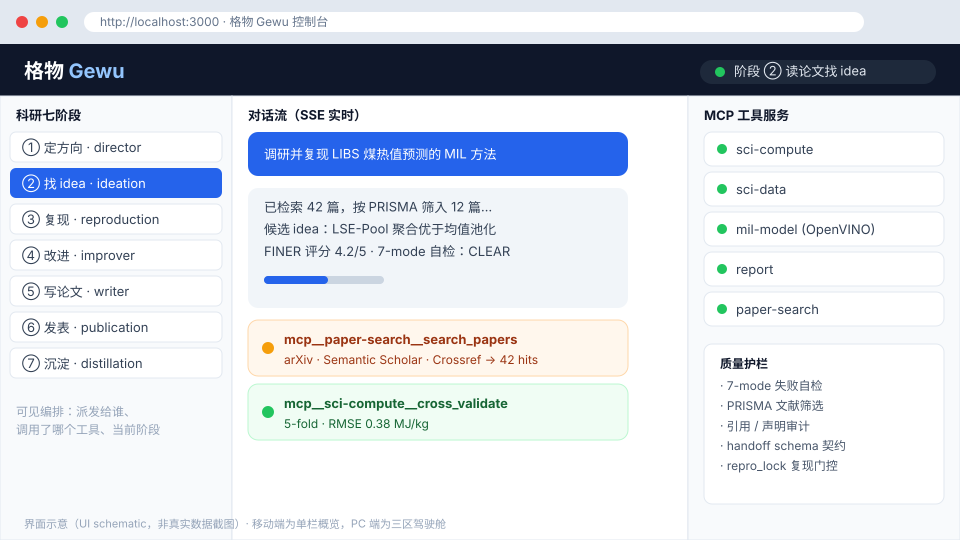

<div align="center">

# 格物 (Gewu) — 通用学术科学智能体

基于 **书生大模型（Intern-S2 系列）** + **OpenClaw 原生编排** 的科研全生命周期智能体：
覆盖 **定方向 → 读论文找 idea → 复现 → 改进 → 写论文 → 发表追踪 → 沉淀**，
并把沉淀的方法固化为可复用 Skill，让系统越用越强。


简体中文

</div>

> 最近更新：**2026-10-22** · 仓库地址：<https://github.com/fresshman/gewu-sciagent>

## 目录

- [特性](#特性)
- [项目定位](#项目定位)
- [界面概览](#界面概览)
- [架构](#架构)
- [七阶段与 Agent 分工](#七阶段与-agent-分工)
- [MCP 工具服务](#mcp-工具服务)
- [目录结构](#目录结构)
- [快速开始](#快速开始)
- [Web 界面（可选）](#web-界面可选)
- [配置与隐私](#配置与隐私)
- [常见问题](#常见问题)
- [文档](#文档)
- [贡献](#贡献)
- [联系与社区](#联系与社区)
- [许可证](#许可证)
- [致谢](#致谢)

---

## 特性

- **科研全生命周期**：从选题到沉淀串联科研每个环节，而非单点辅助工具。
- **通用内核 + 可插拔领域包**：换领域只需替换 `gewu/domain_packs/` 下的领域包，流程不变。
- **可见的编排**：Web 界面能看见 Director 派发给谁、调用了哪个工具、处于哪一阶段。
- **质量护栏**：7-mode 失败自检、PRISMA 式文献筛选、引用与声明审计，主动抑制幻觉与自欺。
- **沉淀复利闭环**：第 ⑦ 阶段把方法与踩坑固化为 OpenClaw Skill + 长周期记忆。
- **科研阅读闭环（最大化书生多模态）**：反幻觉校验（arXiv/CrossRef/S2 三层）→ **原页多模态理解**（`sheng/intern-s2` 直接读 PDF 原页的图/表/公式做跨模态联合推理，而非先经视觉模型转文本）→ 本机书生对抗评审循环。书生在格物里同时是「长程科研智能体调度器」「通专融合内核」与「科学多模态原页理解承载者」，三项能力均被功能化使用。

## 项目定位

| 维度 | 说明 |
|---|---|
| **全生命周期** | 从选题到沉淀串联科研的每个环节，而非单点辅助 |
| **通用内核 + 可插拔领域包** | 「大颗粒原煤 LIBS 光谱热值预测」只是首个**参考实现**；换领域只需替换 `gewu/domain_packs/` 下的领域包 |
| **沉淀复利闭环** | 第 ⑦ 阶段把方法与踩坑固化为 OpenClaw Skill + 长周期记忆，系统随使用不断变强 |
| **可见的编排** | Web 界面能看见 Director 派发给谁、调用了哪个工具、当前处于哪一阶段 |
| **质量护栏** | 7-mode 失败自检、PRISMA 式文献筛选、引用与声明审计，主动抑制幻觉与自欺 |

## 界面概览

自研轻量 Web 前端（移动优先概览面 + PC 三区驾驶舱），经本地 Node 代理接入 OpenClaw Gateway：



> 上方为界面示意图（UI schematic），展示 PC 端三区布局：左侧科研七阶段、中间 SSE 实时对话流与工具调用卡片、右侧 MCP 服务状态与质量护栏。

## 架构

| 层 | 角色 | 落地 |
|---|---|---|
| 书生大模型（Intern-S2 / Intern-S1 / InternVL） | 大脑 | OpenAI 兼容接口接入 OpenClaw model provider |
| OpenClaw | 执行框架 | 原生多智能体编排、Skills、长周期记忆、A2A |
| 格物层 | 科研能力 | 7 个阶段 Agent + 8 个 MCP 工具服务（7 Python + 1 Node 包装）+ 领域包 + Skills |

**不自己写控制流编排器**：7 阶段流程交由 OpenClaw 原生多智能体编排，
Python 侧只保留「科学工具层」（MCP Server），通过 MCP 被 OpenClaw 调用。

## 七阶段与 Agent 分工

| # | 阶段 | Agent | 主要工作 |
|---|---|---|---|
| ① | 定方向 | `gewu-director` | 主编：澄清研究问题、拆解目标、派发子任务并收敛结果 |
| ② | 读论文找 idea | `gewu-ideation` | 多源检索、PRISMA 式筛选、按 FINER 给选题打分 |
| ③ | 复现 | `gewu-reproduction` | 复现基线、复现门控与 `repro_lock`、真值隔离 |
| ④ | 改进 | `gewu-improver` | 多视角评分、消融实验与迭代改进 |
| ⑤ | 写论文 | `gewu-writer` | 成稿，并执行引用与声明审计（claim-audit） |
| ⑥ | 发表追踪 | `gewu-publication` | 投稿策略、期刊匹配、进度追踪 |
| ⑦ | 沉淀 | `gewu-distillation` | 固化为 Skill + 长周期记忆，形成复利闭环 |

各阶段产出写入 `handoff_<stage>.json`，下游按 schema 消费，避免上下文丢失。

## MCP 工具服务

| 服务 | 能力 |
|---|---|
| `sci-compute` | PCA / PLS / 曲线拟合 / 交叉验证 等科学计算 |
| `sci-data` | 光谱等科学数据的读取与预处理 |
| `mil-model` | MIL 模型推理（支持 OpenVINO 本地推理） |
| `report` | 报告与论文草稿生成；并含「本地写 LaTeX」工具族（write_local_file / write_latex_project / copy_local_file），把 .tex/.bib 源文件落盘本机，不依赖 Overleaf |
| `sci-plot` | 含实验数据的统计图（本地 matplotlib 渲染，PDF 矢量 + PNG 300dpi，数据不出本机，17 工具） |
| `chart-cloud` | 纯结构/概念图（包装 @antv/mcp-server-chart，云端出图：思维导/桑基/鱼骨/组织架构/地图等 12 工具；已禁用全部含数据图类型） |
| `office-word` | 本地生成/排版 Word 文档（python-docx，54 工具；标题/段落/表格/底纹合并/字体颜色/搜索替换/convert_to_pdf 等），用于中文期刊/学位论文成稿 |
| `paper-search` | 多源论文检索（arXiv / Semantic Scholar / Crossref / OpenAlex / PubMed） |

## 目录结构

```
gewu-sciagent/
├── README.md                  # 本文件
├── LICENSE                    # Apache-2.0
├── NOTICE                     # 第三方方法论借鉴署名
├── requirements.txt           # Python MCP 工具层依赖
├── .env.example               # 环境变量示例（真实值填 .env，已被 Git 忽略）
├── .gitignore
├── docs/
│   ├── architecture.md        # 架构设计与落地路线图
│   └── images/ui-overview.svg # 界面示意图
├── data/                      # 数据集（大文件建议放网盘，仅留索引）
├── web/                       # 自研轻量 Web 前端 + 本地代理
│   ├── src/                   # React + Vite + TypeScript 前端
│   └── proxy/server.mjs       # 零依赖 Node 代理（托管前端 + 反代 Gateway + SSE 透传）
├── openclaw/                  # OpenClaw 配置与 Agent 工作区
│   ├── openclaw.json          # 网关配置（模型 / Agents / MCP；凭据用占位符）
│   ├── skills/                # Skill 源（research_lifecycle 等）
│   └── workspace/
│       ├── MEMORY.md          # 共享长周期记忆
│       └── agents/<role>/     # 7 个 Agent 工作区（AGENTS.md + skills/ + MEMORY.md）
└── gewu/                      # Python 工具层（经 MCP 被 OpenClaw 调用）
    ├── mcp/                   # 8 个 stdio MCP Server（sci_compute/sci_data/mil_model/report/sci_plot/office-word 为 Python；chart_cloud.mjs 为 Node 包装）
    ├── skills/                # OpenClaw Skills 源（SKILL.md）
    └── domain_packs/          # 可插拔领域包：coal_libs（LIBS 煤热值参考实现）
```

## 快速开始

### 前置要求

| 依赖 | 最低版本 | 说明 |
|---|---|---|
| **Node.js** | ≥ 24.16（且 < 25）或 ≥ 26.1 | OpenClaw 的硬性要求 |
| **Python** | 3.10+ | MCP 工具层 |
| **书生大模型 API Key** | — | 见下方「配置与隐私」 |

> ⚠️ Python 侧需 `mcp` **1.x**：`mcp` 2.x 重命名了 `FastMCP`，会导致 MCP 服务导入失败。

### 1. 安装 OpenClaw（Node 全局）

```bash
npm i -g openclaw@2026.10.5
```

### 2. 安装 Python 依赖（建议独立 venv）

```bash
python -m venv .venv
source .venv/bin/activate        # Windows: .venv\Scripts\activate
pip install -r requirements.txt  # 注意需 mcp 1.x
```

### 3. 配置模型与凭据

```bash
cp .env.example .env             # 填入你的 INTERN_API_KEY
# 真实 Key 也可直接写入 ~/.openclaw/openclaw.json（位于用户目录，不进 Git）
```

将 `openclaw/openclaw.json` 的内容合并进 `~/.openclaw/openclaw.json`
（该模板中的 API Key 为 `${INTERN_API_KEY}` 占位符，不会泄露密钥）。

### 4. 启动网关并验证

```bash
openclaw gateway run --force     # 常驻，默认 127.0.0.1:18789
openclaw gateway probe           # 验证连通
openclaw config validate         # 校验配置
openclaw mcp probe               # 验证 8 个 MCP 服务
```

### 5. 发起科研目标

```bash
openclaw agent --agent gewu-director \
  -m "调研并复现大颗粒原煤 LIBS 光谱热值预测的 MIL 方法，给出 5 折交叉验证指标"
```

## Web 界面（可选）

自研轻量前端，统一体验入口：移动优先（概览面）+ PC 三区驾驶舱（全量面）。

```bash
cd web
npm install
npm run dev        # 开发：前端 :5173 （/api 反代到本机代理 :3000）
npm run build && npm start   # 生产：单端口 :3000 同时提供前端与 API
```

## 配置与隐私

本项目对凭据处理遵循以下原则，**仓库中不含任何真实密钥或个人身份信息**：

| 措施 | 说明 |
|---|---|
| **环境变量注入** | API Key 通过 `INTERN_API_KEY` 环境变量提供 |
| **配置模板占位** | `openclaw/openclaw.json` 中写作 `${INTERN_API_KEY}`，提交到仓库的只是占位符 |
| **真实凭据不入库** | 真实 Key 只写入 `~/.openclaw/openclaw.json`（位于用户目录，不进 Git） |
| **`.env` 已忽略** | `.gitignore` 忽略 `.env` 与 `.env.*`，仅提交 `.env.example` 占位示例 |
| **运行时文件不入库** | `.gitignore` 忽略 OpenClaw 的 `SOUL.md` / `IDENTITY.md` / `USER.md` / `agents/*/MEMORY.md`，避免个人信息与本地状态误提交 |

提交前建议自查：

```bash
grep -rInE "sk-[A-Za-z0-9]{16,}|1[3-9][0-9]{9}" --exclude-dir=node_modules --exclude-dir=.git .
```

> ⚠️ `openclaw/openclaw.json` 中的 MCP `command` 路径为 `<user>` 占位符，
> **换机部署时**需替换为本机的 Python venv 绝对路径。

## 常见问题

**Q1：安装 OpenClaw 时报 Node 版本不满足？**
A：OpenClaw 要求 Node ≥ 24.16（且 < 25）或 ≥ 26.1。若本机只有 22 / 24.13，需单独安装 Node 26.x 并让 `openclaw` 命令指向它（见 `docs/architecture.md`）。

**Q2：启动 MCP 服务报 `cannot import name 'FastMCP'`？**
A：需 `mcp` 1.x；`mcp` 2.x 把 `FastMCP` 重命名为 `MCPServer` 导致导入失败。新建 venv 并执行 `pip install "mcp<2"`。

**Q3：调用书生 API 返回 `API token scope forbidden for this domain`？**
A：书生 API **调用**的 baseUrl 必须是 `https://chat.intern-ai.org.cn/api/v1`，而非 `internlm.intern-ai.org.cn` 域；令牌本身有效，是域 scope 不匹配。

**Q4：真实 API Key 应该放在哪里？**
A：只写入用户目录的 `~/.openclaw/openclaw.json`；仓库内的 `openclaw/openclaw.json` 用 `${INTERN_API_KEY}` 占位，不进 Git，可安全公开。

**Q5：如何切换到其他科研领域？**
A：替换 `gewu/domain_packs/` 下的领域包即可，通用内核与七阶段流程不变。当前内置参考实现为 LIBS 大颗粒原煤热值预测（`coal_libs`）。

## 文档

| 文档 | 内容 |
|---|---|
| [`docs/architecture.md`](docs/architecture.md) | 架构设计、配置要点与分阶段落地路线图 |

## 贡献

欢迎提交 Issue 与 Pull Request 参与完善。提交前请：

- 运行上方「提交前自查」命令，确认无密钥/个人信息泄露；
- 保持 `openclaw/openclaw.json` 中的 API Key 为 `${INTERN_API_KEY}` 占位；
- 新增领域包请放在 `gewu/domain_packs/` 下，遵循现有结构。

Issue 入口：<https://github.com/fresshman/gewu-sciagent/issues>

## 联系与社区

- 问题反馈与讨论：<https://github.com/fresshman/gewu-sciagent/issues>
- 功能建议与路线图：欢迎在 Issues 中开题，标签 `enhancement`

## 许可证

本项目采用 **Apache-2.0** 许可证，详见 [`LICENSE`](LICENSE)。

第三方署名与方法论借鉴说明见 [`NOTICE`](NOTICE)。

## 致谢

- **书生大模型**（Intern-S2 / Intern-S1 / InternVL）—— 提供模型能力
- **OpenClaw** —— 多智能体编排与运行时框架
- **paper-search-mcp**（MIT）—— 多源论文检索 MCP 服务
- **academic-research-skills** —— 借鉴其科研质量护栏的方法论思想
  （该仓库为 CC-BY-NC 4.0，本项目**仅借鉴方法论、未复制其代码与文本**，署名见 `NOTICE`）
