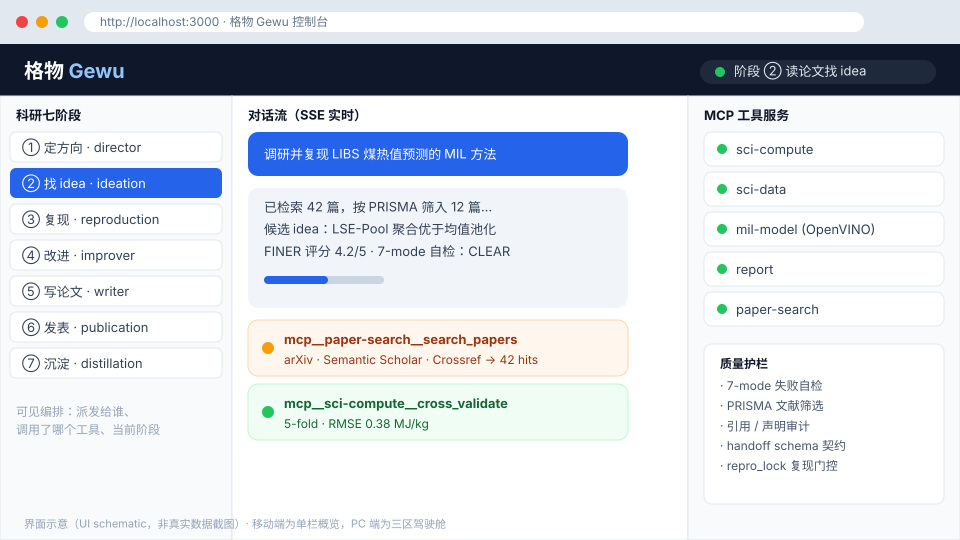

<div align="center">

# 格物 (Gewu) — 通用学术科学智能体

基于 **书生大模型（Intern-S2 系列）** + **OpenClaw 原生编排** 的科研全生命周期智能体：
覆盖 **定方向 → 读论文找 idea → 复现 → 改进 → 写论文 → 发表追踪 → 沉淀**，
并把沉淀的方法固化为可复用 Skill，让系统越用越强。


简体中文

</div>

> 最近更新：**2026-11-04** · 权威仓库（已验证公开可访问）：<https://gitee.com/FreeBlank/gewu-sciagent>

## 目录

- [特性](#特性)
- [项目定位](#项目定位)
- [界面概览](#界面概览)
- [架构](#架构)
- [七阶段与 Agent 分工](#七阶段与-agent-分工)
- [MCP 工具服务](#mcp-工具服务)
- [目录结构](#目录结构)
- [快速开始](#快速开始)
- [Web 界面（可选）](#web-界面可选)
- [配置与隐私](#配置与隐私)
- [常见问题](#常见问题)
- [文档](#文档)
- [贡献](#贡献)
- [联系与社区](#联系与社区)
- [许可证](#许可证)
- [致谢](#致谢)

---

## 特性

- **科研全生命周期**：从选题到沉淀串联科研每个环节，而非单点辅助工具。
- **通用内核 + 可插拔领域包**：换领域只需替换 `gewu/domain_packs/` 下的领域包，流程不变。
- **可见的编排**：Web 界面能看见 Director 派发给谁、调用了哪个工具、处于哪一阶段。
- **质量护栏**：7-mode 失败自检、PRISMA 式文献筛选、引用与声明审计，主动抑制幻觉与自欺。
- **真实领域推理 + 未发表成果零外泄**：领域模型走「**路径引用**」而非复制入库——模型权重（`.pt`）与未发表实验数据始终留在用户本机原项目，格物只按 `COAL_PROJECT_ROOT` 运行时读取，可跑出**真实、可复现**的预测与 5 折交叉验证指标，而资产不进仓库、不上云。
- **沉淀复利闭环**：第 ⑦ 阶段把方法与踩坑固化为 OpenClaw Skill + 长周期记忆。
- **科研阅读闭环（最大化书生多模态）**：反幻觉校验（arXiv/CrossRef/S2/CrossRef 标题回退四层）→ **原页多模态理解**（`sheng/intern-s2` 直接读 PDF 原页的图/表/公式做跨模态联合推理，而非先经视觉模型转文本）→ 本机书生对抗评审循环。书生在格物里同时是「长程科研智能体调度器」「通专融合内核」与「科学多模态原页理解承载者」，三项能力均被功能化使用。**原页理解已用真实论文两轮实测**：中文 LIBS 论文一輪读出图内标注 `RMSEp=1.097`、PCA 方差解释率 `PC1 47.9%/43.2%` 等**纯文本抽取拿不到的数值**，并通过「结果页+方法页」联合推理发现跨页归因缺口；三篇英文正式期刊论文一輪（Talanta 2025 / Spectrochim. Acta B 2024 / JAAS，DOI 均已核验，见 [`docs/verification/2026-10-23-english-papers.md`](docs/verification/2026-10-23-english-papers.md)）在文本层仅剩图注的页面上完整读出流程图步骤与方法示意图符号，且能识别「图中未标注」而不把正文表格数字冒充为图内读数。实测同时暴露两类风险（数字末位/位序误读、长输出前后矛盾），已固化为技能纪律：关键数字二次复读并与正文表格对照、结构化表格一次性输出。

## 项目定位

| 维度 | 说明 |
|---|---|
| **全生命周期** | 从选题到沉淀串联科研的每个环节，而非单点辅助 |
| **通用内核 + 可插拔领域包** | 「大颗粒原煤 LIBS 光谱热值预测」只是首个**参考实现**；换领域只需替换 `gewu/domain_packs/` 下的领域包 |
| **沉淀复利闭环** | 第 ⑦ 阶段把方法与踩坑固化为 OpenClaw Skill + 长周期记忆，系统随使用不断变强 |
| **可见的编排** | Web 界面能看见 Director 派发给谁、调用了哪个工具、当前处于哪一阶段 |
| **质量护栏** | 7-mode 失败自检、PRISMA 式文献筛选、引用与声明审计，主动抑制幻觉与自欺 |

## 界面概览

自研轻量 Web 前端（移动优先概览面 + PC 三区驾驶舱），经本地 Node 代理接入 OpenClaw Gateway：



> 上方为界面示意图（UI schematic），展示 PC 端三区布局：左侧科研七阶段、中间 SSE 实时对话流与工具调用卡片、右侧 MCP 服务状态与质量护栏。

## 架构

| 层 | 角色 | 落地 |
|---|---|---|
| 书生大模型（Intern-S2 / Intern-S1 / InternVL） | 大脑 | OpenAI 兼容接口接入 OpenClaw model provider |
| OpenClaw | 执行框架 | 原生多智能体编排（`sessions_spawn` / `sessions_send` / `agents_wait`）、Skills 加载、长周期记忆、渠道 |
| 格物层 | 科研能力 | 7 个阶段 Agent + 10 个 MCP 服务（本机 8 个：7 Python + 1 Node 包装；另 2 个为外部包）+ 领域包 + Skills |

**不自己写控制流编排器**：7 阶段流程交由 OpenClaw 原生多智能体编排，
Python 侧只保留「科学工具层」（MCP Server），通过 MCP 被 OpenClaw 调用。

> **能力口径说明**：上表列的是 OpenClaw 框架自身具备的能力。本项目**实际使用**的是原生多智能体
> 编排（主编 `sessions_spawn` 派发 6 个子智能体，跨阶段交接经 `handoff_<stage>.json` 落盘回传）；
> **未使用 A2A 协议层**，也**未接入 Computer Use**。二者不列为本作品的实现内容。

## 七阶段与 Agent 分工

| # | 阶段 | Agent | 主要工作 |
|---|---|---|---|
| ① | 定方向 | `gewu-director` | 主编：澄清研究问题、拆解目标、派发子任务并收敛结果 |
| ② | 读论文找 idea | `gewu-ideation` | 多源检索、PRISMA 式筛选、按 FINER 给选题打分 |
| ③ | 复现 | `gewu-reproduction` | 复现基线、复现门控与 `repro_lock`、真值隔离 |
| ④ | 改进 | `gewu-improver` | 多视角评分、消融实验与迭代改进 |
| ⑤ | 写论文 | `gewu-writer` | 成稿，并执行引用与声明审计（claim-audit） |
| ⑥ | 发表追踪 | `gewu-publication` | 投稿策略、期刊匹配、进度追踪 |
| ⑦ | 沉淀 | `gewu-distillation` | 固化为 Skill + 长周期记忆，形成复利闭环 |

各阶段产出写入 `handoff_<stage>.json`，下游按 schema 消费，避免上下文丢失。

## MCP 工具服务

下表「工具数」= 网关 live 工具面上该 server 的**业务工具**数（已扣掉 FastMCP 给每个 server
自带的 4 个模板工具 `prompts_get/prompts_list/resources_list/resources_read`）。
本仓自研的是 **7 个 Python server、共 48 个工具**（与 `gewu/mcp/*.py` 里 `@mcp.tool()`
的装饰器总数逐一对齐）；`chart-cloud` 的 12 个是对外部 AntV 包做**白名单放行**后的子集，
不是自研工具；再加两个外部包，live 面共 10 个 server、171 个业务工具。

| 服务 | 工具数 | 能力 |
|---|---|---|
| `sci-compute` | 4 | PCA / PLS / 曲线拟合 / 交叉验证 等科学计算 |
| `sci-data` | 5 | 多模态科学数据：`pdf_page_map` 探含图页 → `render_pdf_pages` 渲染 → `image_to_data_uri` 供书生原页理解，外加 `expand_result` 回取原文 |
| `sci-verify` | 8 | **反幻觉核验服务**：`verify_papers`（CrossRef/arXiv/Semantic Scholar/OpenAlex 四层）/ `verify_claims` 数值声明溯源 / `save_claims` / `lint_citations` 引用完整性 / `verify_source_span` 原页文本层核验 / `get_journal_rank` 期刊等级分区 |
| `sci-exp` | 4 | 领域无关实验注册表：登记 / 查询 / 审计 / 重跑（`rerun_experiment`） |
| `mil-model` | 6 | **真实** MIL 热值预测：`predict_calorific_value` 单 bag / `list_val_bags` 验证集列举 / `reproduce_fold` 复现某折 / `cv_summary` 5 折汇总 / `get_cached_metrics` 秒级读缓存指标（零 torch）/ `expand_result`。经 `coal_infer.py` 按路径引用外部未发表项目的 `.pt`+`.pkl` 做真实前向推理，可逐 bag 复现 5 折交叉验证 |
| `sci-plot` | 17 | 含实验数据的统计图（本地 matplotlib 渲染，PDF 矢量 + PNG 300dpi，数据不出本机） |
| `report` | 4 | 报告与论文草稿生成；含「本地写 LaTeX」工具族（write_local_file / write_latex_project / copy_local_file），把 .tex/.bib 源文件落盘本机，不依赖 Overleaf |
| `chart-cloud` | 12 | 纯结构/概念图（包装 `@antv/mcp-server-chart`，云端出图：思维导图/桑基/鱼骨/组织架构/地图等；已禁用全部含数据图类型 15 个） |
| `paper-search` | 57 | **外部包** `paper-search-mcp`（非本仓代码），多源论文检索（arXiv / Semantic Scholar / Crossref / OpenAlex / PubMed） |
| `office-word` | 54 | **外部包** `word-document-server`（非本仓代码，`-m word_document_server.main` 起），本地生成/排版 Word（python-docx：标题/段落/表格/底纹合并/字体颜色/搜索替换/convert_to_pdf），用于中文期刊与学位论文成稿 |

## 目录结构

```
gewu-sciagent/
├── README.md                  # 本文件
├── LICENSE                    # Apache-2.0
├── NOTICE                     # 第三方方法论借鉴署名
├── requirements.txt           # Python MCP 工具层依赖（只含本仓代码实际导入的包）
├── requirements-coal.txt      # 可选：跑 MIL 真实推理才需要的 torch
├── .env.example               # 环境变量示例（真实值填 .env，已被 Git 忽略）
├── .gitignore
├── docs/
│   ├── architecture.md        # 架构设计与落地路线图
│   ├── verification/          # 端到端实测记录（含反幻觉链与缺口清单）
│   └── images/ui-overview.svg # 界面示意图
├── tests/                     # Python 侧 9 个测试文件 / 68 用例（反幻觉、瘦身层、超时层级等）
├── scripts/                   # bootstrap_openclaw_config（生成网关配置）/ create_project /
│                              #   export_case_bundle / e2e_smoke_test / pdf_tool
├── start-gewu.sh              # 一键拉起网关 + 代理 + 前端；--check 只自检环境，不启动进程
├── data/                      # 数据集（大文件建议放网盘，仅留索引）
├── web/                       # 自研轻量 Web 前端 + 本地代理
│   ├── src/                   # React + Vite + TypeScript 前端
│   ├── proxy/server.mjs       # 零依赖 Node 代理（托管前端 + 反代 Gateway + SSE 透传 + 长任务后台化/预算闸门）
│   ├── shared/                # 代理里可单测的那一层：
│   │   ├── run_budget.mjs     #   预算阈值状态机（在飞 exceeded / 收尾后 overrun 分开）
│   │   ├── trace_source.mjs   #   在飞轨迹真值：只读网关 transcript_events 表，边跑边数工具调用
│   │   ├── tail_time.mjs      #   `sessions tail` 回放划界：上一轮的历史不入账、不驱动收口
│   │   ├── session_key.mjs    #   agent:<id>:<key> 会话名归一（否则 tail 与轮次落在两个会话）
│   │   └── notes_digest.mjs   #   工具结果压缩（摘要 + 原文落盘 + 回取）
│   └── tests/                 # node --test "tests/**/*.test.mjs"
├── openclaw/                  # OpenClaw 配置与 Agent 工作区
│   ├── openclaw.json          # 网关配置（模型 / Agents / MCP；凭据用占位符）
│   ├── skills/                # Skill 源（research_lifecycle 等）
│   └── workspace/
│       ├── MEMORY.md          # 共享长周期记忆（入库）
│       └── agents/<role>/     # 7 个 Agent 工作区（AGENTS.md + skills/；各角色 MEMORY.md 由运行时写入，刻意不入库）
├── output/                    # 运行产物与一次性脚本（Git 忽略）
│   └── scratch/               # 调试/校验/演练驱动脚本统一放这里，新建前先在本节留指针
└── gewu/                      # Python 工具层（经 MCP 被 OpenClaw 调用）
    ├── mcp/                   # 8 个本机 stdio MCP Server 文件：sci_compute / sci_data / sci_exp /
    │                          #   sci_plot / mil_model / report / verify_server（Python，7 个）
    │                          #   + chart_cloud.mjs（Node 包装）；另有 paper-search / office-word
    │                          #   两个外部包以 -m 方式接入，代码不在本仓
    ├── skills/                # OpenClaw Skills 源（SKILL.md）
    └── domain_packs/          # 可插拔领域包：coal_libs（LIBS 煤热值参考实现）
```

`output/scratch/` 里放的是不留存证据的一次性驱动脚本，同一个校验目标只保留一个入口脚本，
新的检查项应作为该脚本的函数、命令行参数或用例表追加，而不是另建兄弟文件。
当前指针：`drill_check.py`（七阶段演练校验唯一入口）——`mcp` 子命令直接起 mil-model MCP 复算
stage3/stage4 声明的数字（`get_cached_metrics`/`cv_summary`/`reproduce_fold`/`predict_calorific_value`
与逐 bag 预测）；`post`/`poll` 走同一 sessionKey 续跑验断点续跑；`gate`/`probe` 用裸 sessionKey
打一轮轻量指令，每 3 秒采一次 `/api/run` 的在飞用量，验「轨迹在轮次进行中就到位、预算闸门
在越线那一刻触发（`budget.exceeded`，而不是收尾后补记）、历史回放既不计数也不提前收口」。

## 快速开始

### 前置要求

| 依赖 | 最低版本 | 说明 |
|---|---|---|
| **Node.js** | ≥ 24.16（且 < 25）或 ≥ 26.1 | OpenClaw 的硬性要求 |
| **Python** | 3.10+ | MCP 工具层 |
| **书生大模型 API Key** | — | 见下方「配置与隐私」 |

> ⚠️ Python 侧需 `mcp` **1.x**：`mcp` 2.x 重命名了 `FastMCP`，会导致 MCP 服务导入失败。

### 1. 安装 OpenClaw（Node 全局）

```bash
npm i -g openclaw@2026.10.5
```

### 2. 安装依赖（Python 建议独立 venv）

```bash
python -m venv .venv
source .venv/bin/activate        # Windows: .venv\Scripts\activate
pip install -r requirements.txt  # 只含本仓代码实际导入的包，注意需 mcp 1.x
```

`requirements.txt` 覆盖 7 个自研 **Python** MCP 服务（sci-compute / sci-data / sci-exp /
sci-plot / mil-model / report / sci-verify）。剩下 3 个不在这一份依赖里：

```bash
npm install -g @antv/mcp-server-chart    # chart-cloud：Node 包装，gewu/mcp/chart_cloud.mjs 经 npm root -g 定位入口
pip install paper-search-mcp==0.1.4      # 外部包，模块 paper_search_mcp.server（多源论文检索）
pip install office-word-mcp-server==1.1.11  # 外部包，模块 word_document_server.main（Word 成稿排版）
```

> 这两个外部包**各用自己独立 venv**（配置里 `command` 指向各自解释器）。实测原因不同：
> `office-word-mcp-server` 依赖 `mcp` **2.x**（本机装到 2.3.0），和自研服务的 `mcp<2` 是硬冲突，
> 合环境会当场把 7 个自研服务打挂；`paper-search-mcp` 依赖 `mcp` 1.30（与自研同版本），
> 独立环境是隔离它带来的 cyclopts/Authlib 等一圈依赖，不是版本冲突。

> 只有要跑 **MIL+LIBS 真实推理**时才需要 torch：`pip install -r requirements-coal.txt`。
> 它由 `GEWU_COAL_PYTHON` 指向的解释器作为子进程调用，属于外部未发表项目的模型环境；
> 不装时 mil-model 的真实推理工具返回 `status:"not-configured"` 并给出提示，不会编造指标。

### 3. 生成网关配置（不要手工改路径）

仓库里的 `openclaw/openclaw.json` 是**带注释的 JSONC 模板**，里面有 26 处指向仓库根的绝对路径
（网关 workspace + 7 个角色工作区 + 各 MCP 服务的 `args`/`cwd`），另有 10 处解释器路径写成
`C:/Users/<user>/...`。手工照着改既容易漏又无法验证，所以用脚本生成：

```bash
python scripts/bootstrap_openclaw_config.py            # 干跑：打印替换清单 + 检查结论 + 与现有配置的 diff
python scripts/bootstrap_openclaw_config.py --check    # 只检查，有问题退出码非 0（适合放进 CI）
python scripts/bootstrap_openclaw_config.py --write    # 写入 ~/.openclaw/openclaw.json（已存在则先备份）
```

脚本按**当前仓库根**与**当前解释器**重写路径，并检查花括号配平、10 个 MCP server、
7 个 Agent、workspace 是否真实存在、`command:` 指向的解释器是否可用、Node 版本是否满足
openclaw 闸门。`--python` 默认取运行本脚本的解释器——**请用装了 `mcp<2/numpy/pymupdf` 的那个
venv 跑它**，否则生成的配置会指向一个起不来的解释器。另外两个外部包各用自己独立 venv：

```bash
# --node 给 chart-cloud 用；另两个外部包各自独立 venv
python scripts/bootstrap_openclaw_config.py \
  --node /path/to/node \
  --paper-python /path/to/paper-env/bin/python \
  --office-python /path/to/office-env/bin/python \
  --write
```

不给这两个参数时检查会以 `fail` 级报出（配置里会留下 `<user>` 占位，那两个 server 起不来），
这是故意的——比生成一份"看起来成功了"的配置更有用。

模板里的 API Key 写成 `${INTERN_API_KEY}`，密钥因此不进 Git：

```bash
cp .env.example .env             # 填入你的 INTERN_API_KEY（其余变量都有默认值，按需再调）
export INTERN_API_KEY=sk-...     # 或让网关进程能读到它
```

生成的配置可以直接交给网关校验（本机实测结论）：

```bash
openclaw config validate         # → Config valid（2 条 warning：heartbeat 与网关 token 未设，均属可选）
```

### 4. 启动网关并验证

一键脚本（同时拉起网关与前端，Node/openclaw 路径自动解析，无需改脚本）：

```bash
bash start-gewu.sh --check       # 只自检：Node 闸门 / openclaw 入口 / 配置 / 端口 / 前端依赖
bash start-gewu.sh               # 起网关 + 前端（Ctrl+C 一并关闭）
bash start-gewu.sh --gateway     # 只起网关
```

手动方式：

```bash
openclaw gateway run --force     # 常驻，默认 127.0.0.1:18789
openclaw gateway probe           # 验证连通
openclaw config validate         # 校验配置
openclaw mcp probe               # 验证 10 个 MCP 服务（8 个本机 + 2 个外部包）
```

### 5. 跑测试（两套件，共 116 用例）

```bash
# Python 侧：反幻觉链 / 结果瘦身层 / MCP 超时层级 / stdin 守护
python -m pytest tests -q              # 共 68 用例
#   允许跳过 0–2 个，取决于两个外部条件，都不是代码失败：
#   ① test_verify_papers_fallback —— CrossRef 限流或断网时返回 verify_pending 而跳过；
#   ② test_mcp_timeout_hierarchy —— 解包目录里没有 gitignore 的 .coal_project_root 时跳过。
#   所以同一份代码会跑出 68/0、67/1、66/2 三种数，用 `-rs` 可以看到每条跳过的原因。
#   实测（2026-11-04）：仓库内 68 passed / 0 skipped（9.91s）；
#   干净解包（只有 git 跟踪的文件、无 .coal_project_root）67 passed / 1 skipped（16.60s）。
#   完整开箱演练记录见 docs/verification/2026-11-04-clean-unpack-drill.md。

# Web 代理侧：预算状态机 / 会话名归一 / tail 划界 / transcript 读取 / 笔记摘要
cd web && node --test "tests/**/*.test.mjs"   # 48 pass
#   必须写成 glob：`node --test tests/` 在部分 Node 版本上 MODULE_NOT_FOUND。
#   需要 Node ≥ 22.5（用到 node:sqlite 与 zlib.zstdDecompressSync，实测用 26.9.0）。
```

### 6. 创建科研项目（多项目隔离）

格物支持**多项目并行隔离**：每个科研项目有独立的目录结构、数据集、模型权重、handoff 文件，互不干扰。

```bash
# 创建 LLM 微调项目
python scripts/create_project.py llm-finetune \
  --domain nlp \
  --display-name "LLM 微调实验" \
  --description "基于书生大模型的 LoRA/QLoRA 微调"

# 创建 YOLO 目标检测项目
python scripts/create_project.py yolo-detection \
  --domain cv \
  --display-name "YOLO 目标检测" \
  --description "基于 YOLOv8 的工业缺陷检测"

# 查看已创建项目
cat ~/.gewu/config.json | jq .projects
```

**项目目录结构**：
```
~/.gewu/
├── config.json                   # 全局配置（活跃项目、项目列表）
├── projects/
│   ├── coal-thermal/             # 煤炭热值项目（示例）
│   │   ├── project.json          # 项目元数据
│   │   ├── data/                 # 数据集
│   │   ├── models/               # 模型权重
│   │   ├── handoffs/             # 七阶段 handoff 文件
│   │   ├── output/               # 报告、图表
│   │   └── logs/                 # 运行日志
│   ├── llm-finetune/             # LLM 微调项目
│   └── yolo-detection/           # YOLO 检测项目
└── global/
    ├── mcp-servers/              # 全局 MCP server
    ├── skills/                   # 通用技能
    └── templates/                # 项目模板
```

**切换活跃项目**：编辑 `~/.gewu/config.json` 的 `active_project` 字段。

> 💡 **当前状态**：阶段1（项目注册表）已实现，支持多项目隔离。
> 阶段2（Computer Use 接入）**未实现**——那是 OpenClaw 框架侧能力，本作品没有做，
> 也不把它算进技术难度得分；此处只作为后续方向记录。

### 7. 发起科研目标

```bash
openclaw agent --agent gewu-director \
  -m "调研并复现大颗粒原煤 LIBS 光谱热值预测的 MIL 方法，给出 5 折交叉验证指标"
```

## Web 界面（可选）

自研轻量前端，统一体验入口：移动优先（概览面）+ PC 三区驾驶舱（全量面）。

```bash
cd web
npm install
npm run dev        # 开发：前端 :5173 （/api 反代到本机代理 :3000）
npm run build && npm start   # 生产：单端口 :3000 同时提供前端与 API
```

> 🚀 **一键启动（推荐）**：仓库根目录的 `start-gewu.sh` 已把「后端网关 + 前端 Web」合并为一个命令，
> 且所有路径写死为本机 Node 26 绝对路径（绕过 Git Bash 默认 Node 22 的 openclaw shim）。在 Git Bash 中执行：
> ```bash
> bash start-gewu.sh     # 同时拉起网关(:18789) 与前端(:5173/:3000)，Ctrl+C 一并停止
> ```
> 日志写入 `.aris/logs/`（已在 .gitignore，不入库）。

## 配置与隐私

本项目对凭据处理遵循以下原则，**仓库中不含任何真实密钥或个人身份信息**：

| 措施 | 说明 |
|---|---|
| **环境变量注入** | API Key 通过 `INTERN_API_KEY` 环境变量提供 |
| **配置模板占位** | `openclaw/openclaw.json` 中写作 `${INTERN_API_KEY}`，提交到仓库的只是占位符 |
| **真实凭据不入库** | 真实 Key 只写入 `~/.openclaw/openclaw.json`（位于用户目录，不进 Git） |
| **`.env` 已忽略** | `.gitignore` 忽略 `.env` 与 `.env.*`，仅提交 `.env.example` 占位示例 |
| **运行时文件不入库** | `.gitignore` 忽略 OpenClaw 的 `SOUL.md` / `IDENTITY.md` / `USER.md` / `agents/*/MEMORY.md`，避免个人信息与本地状态误提交 |

提交前建议自查：

```bash
grep -rInE "sk-[A-Za-z0-9]{16,}|1[3-9][0-9]{9}" --exclude-dir=node_modules --exclude-dir=.git .
```

> ⚠️ `openclaw/openclaw.json` 里的 MCP `command` 写成 `C:/Users/<user>/...` 占位，
> **换机部署时**用 `python scripts/bootstrap_openclaw_config.py --write` 生成本机路径，
> 别手工改——脚本会同时校验 10 个 server、7 个 Agent 与解释器是否真的存在。

## 常见问题

**Q1：安装 OpenClaw 时报 Node 版本不满足？**
A：OpenClaw 要求 Node ≥ 24.16（且 < 25）或 ≥ 26.1。若本机只有 22 / 24.13，需单独安装 Node 26.x 并让 `openclaw` 命令指向它（见 `docs/architecture.md`）。`bash start-gewu.sh --check` 会直接把这条闸门结论打出来。

**Q2：启动 MCP 服务报 `cannot import name 'FastMCP'`？**
A：需 `mcp` 1.x；`mcp` 2.x 里 `mcp.server.fastmcp.FastMCP` 这个导入路径已不存在，本仓的 server 文件全部按 1.x 写法导入。新建 venv 并执行 `pip install "mcp<2"`。

**Q3：调用书生 API 返回 `API token scope forbidden for this domain`？**
A：书生 API **调用**的 baseUrl 必须是 `https://chat.intern-ai.org.cn/api/v1`，而非 `internlm.intern-ai.org.cn` 域；令牌本身有效，是域 scope 不匹配。

**Q4：真实 API Key 应该放在哪里？**
A：只写入用户目录的 `~/.openclaw/openclaw.json`；仓库内的 `openclaw/openclaw.json` 用 `${INTERN_API_KEY}` 占位，不进 Git，可安全公开。

**Q5：如何切换到其他科研领域？**
A：替换 `gewu/domain_packs/` 下的领域包即可，通用内核与七阶段流程不变。当前内置参考实现为 LIBS 大颗粒原煤热值预测（`coal_libs`）。

## 文档

| 文档 | 内容 |
|---|---|
| [`docs/architecture.md`](docs/architecture.md) | 架构设计、配置要点与分阶段落地路线图 |
| [`docs/verification/2026-11-04-clean-unpack-drill.md`](docs/verification/2026-11-04-clean-unpack-drill.md) | **开箱可复现演练**：干净解包 → 生成配置 → `config validate` → `mcp probe` 10 服务 → 两套件 → `npm install/build` → 代理起服的真实数字，含演练里发现并修掉的 6 个缺陷与 3 项如实记录的已知缺口 |
| [`docs/verification/anti-hallucination.md`](docs/verification/anti-hallucination.md) | 反幻觉四道横向防线（文献存在性 / 数值溯源 / 引用完整性 / 原页文本层核验）与逐阶段映射 |
| [`docs/verification/2026-10-23-english-papers.md`](docs/verification/2026-10-23-english-papers.md) | 书生 `intern-s2` 科学多模态**原页理解**的三篇英文期刊论文实测（含读出的图内数值与暴露的风险） |
| [`docs/verification/2026-10-23-orchestration-web.md`](docs/verification/2026-10-23-orchestration-web.md) | Web 端多智能体编排实测：主编派发、工具卡片、SSE 轨迹 |
| [`docs/verification/2026-10-23-end2end-gap.md`](docs/verification/2026-10-23-end2end-gap.md) | 端到端缺口清单（哪些环节当时还没跑通） |

## 贡献

欢迎提交 Issue 与 Pull Request 参与完善。提交前请：

- 运行上方「提交前自查」命令，确认无密钥/个人信息泄露；
- 保持 `openclaw/openclaw.json` 中的 API Key 为 `${INTERN_API_KEY}` 占位；
- 新增领域包请放在 `gewu/domain_packs/` 下，遵循现有结构。

Issue 入口：<https://github.com/fresshman/gewu-sciagent/issues>

## 联系与社区

- 问题反馈与讨论：<https://github.com/fresshman/gewu-sciagent/issues>
- 功能建议与路线图：欢迎在 Issues 中开题，标签 `enhancement`

## 许可证

本项目采用 **Apache-2.0** 许可证，详见 [`LICENSE`](LICENSE)。

第三方署名与方法论借鉴说明见 [`NOTICE`](NOTICE)。

## 致谢

- **书生大模型**（Intern-S2 / Intern-S1 / InternVL）—— 提供模型能力
- **OpenClaw** —— 多智能体编排与运行时框架
- **paper-search-mcp**（MIT）—— 多源论文检索 MCP 服务
- **academic-research-skills** —— 借鉴其科研质量护栏的方法论思想
  （该仓库为 CC-BY-NC 4.0，本项目**仅借鉴方法论、未复制其代码与文本**，署名见 `NOTICE`）
