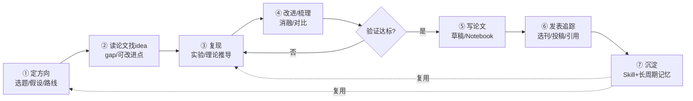

# 架构设计文档 — 格物 (Gewu)

> 通用学术科学智能体。基于 **书生大模型 + OpenClaw 原生编排** 构建；
> 以「大颗粒原煤 LIBS 光谱热值预测」作为**参考实现**证明深度与可复现性。
> OpenClaw 为 **MIT 开源、本地优先** 的执行框架（当前稳定版 v2026.10.x），无需克隆其源码。

### 当前落地状态（2026-10-22 已验证）
- ✅ OpenClaw v2026.10.5 安装并常驻运行（Gateway `gateway probe` 连通，`config validate` 通过）。
- ✅ 书生模型 provider `sheng`（Intern-S1 / InternVL）已配置。
- ✅ 5 个 Python MCP 服务经 `openclaw mcp add` 注册到 `mcp.servers`，`mcp probe` 实测全部拉起并暴露工具。
- ✅ 7 个科研 Agent（`agents.ownership="explicit"`）已注册，各用独立工作区 `AGENTS.md` 承载角色，技能自动发现。
- ⏳ 待办：填 `INTERN_API_KEY` 跑真实规划；导出 OpenVINO MIL 模型 + 接真实 LIBS 数据跑实参考实现；完善技术文档与演示材料。

## 0. 产品定位（与"论文翻译/管理"工具的根本区别）
格物**不是**又一个论文翻译、文献管理或笔记整理工具。它覆盖科研的**全生命周期**，
把智能体从"读文献的助手"升级为"全程参与科研生产的合作者"：

- 普通工具止步于 **读 / 整理**；
- 格物贯穿 **定方向 → 读论文找 idea → 复现 → 改进/梳理 → 写论文 → 发表追踪 → 沉淀**，
- 且「沉淀」把本次方法/知识固化为可复用的 **OpenClaw Skill** 与**长周期记忆**，
  在下一个课题中被直接复用 —— 系统**越用越强（复利闭环）**，这正是科研团队的核心能力。

## 1. 架构总览（原生 OpenClaw）
本项目**不自己写控制流编排器**。OpenClaw 原生已具备：多智能体编排（`sessions_spawn`
支持 `main → orchestrator → worker` 层级）、Skills（`SKILL.md`）、Memory（长周期记忆）、
A2A（announce 跨会话）、Computer Use（Browser/Exec）。因此架构收敛为三层：

| 层 | 角色 | 本项目落地 |
|---|---|---|
| **书生大模型** (Intern-S1 / InternVL) | 大脑（推理 / 规划 / 视觉） | 经 OpenAI 兼容 `base_url` 接入 OpenClaw model profile |
| **OpenClaw** | 执行框架（身体） | Gateway、原生多智能体编排、Skills 加载、Memory、渠道、Computer Use、A2A |
| **格物科研智能体层** | 科研领域能力 | 7 阶段 Agent（注册于 `openclaw.json` 的 `agents.entries`，各用独立工作区 `AGENTS.md` 承载角色）+ Python MCP 工具层 + 领域包 + Skills |

> Python **只保留"科学工具层"**（MCP Server），通过 MCP 被 OpenClaw 调用；
> 控制流（7 阶段流转、迭代循环）完全交给 OpenClaw 原生编排。
> 这样只有**一个 planner**（OpenClaw 自身），不存在"双层 LLM 规划"的效率损耗。

## 2. 科研全生命周期（7 阶段）

- **内循环（假设—实验—验证—迭代）**：①→②→③→④，④ 不达标则回到 ③ 再迭代（命中赛题"端到端科学发现闭环"）。
- **终态阶段**：⑤→⑥→⑦，产出论文、发表追踪与可复用资产。
- **复利**：⑦ 的沉淀在后续课题的 ①/③ 被复用。

> 赛题的「搜、读、算、做、写」是上述生命周期中 **②读 → ③复现 → ④改进 → ⑤写** 的子链；
> 格物在其前后补齐了 ①定方向、⑥发表追踪、⑦沉淀，构成完整科研生产流。

## 3. 原生多智能体编排（OpenClaw 实现）
### 3.1 角色 → OpenClaw Agent 映射
7 个阶段在 OpenClaw 中表达为 **`agents.entries` 里注册的 7 个 Agent**（`agents.ownership="explicit"`，
每个 Agent 有独立工作区，角色由工作区内的 `AGENTS.md` 承载，技能从工作区 `skills/` 自动发现），
由 Director（①）作为协调者通过 `sessions_spawn` 派发后续阶段：

| OpenClaw Agent | 阶段 | 职责 | 关键工具 / 技能 |
|---|---|---|---|
| `director` | ① 定方向 | 提出研究问题、假设、技术路线；协调后续阶段与迭代循环 | 全部 Skills、Memory |
| `ideation` | ② 读论文找 idea | 检索+精读+多模态解析，抽取 gap 与可改进点 | `paper-search` / `sci_data` / InternVL |
| `reproduction` | ③ 复现 | 实验/理论推导复现，调通用计算与领域模型 | `sci_compute` / `mil_model` / Exec |
| `improver` | ④ 改进/梳理 | 消融、对比、复现性验证，并对质量打分 | `sci_compute` / `report` |
| `writer` | ⑤ 写论文 | 论文草稿、图表、可复现 Notebook | `report` / `sci_data` |
| `publication` | ⑥ 发表追踪 | 选刊、投稿、审稿应对、引用追踪 | Browser / `paper-search` |
| `distillation` | ⑦ 沉淀 | 把方法/知识固化为 Skill + 长周期记忆 | Skills 写盘 / Memory |

### 3.2 状态在阶段间的传递
原生 OpenClaw 不走"参数传对象"，而是用三种机制传递科研上下文：
1. **Workspace 文件**：各阶段把产出（假设、文献笔记、实验指标、草稿）写入工作区文件，
   下一阶段读取 —— 大对象（数据集、权重）始终留在 Python/MCP 侧，只跨边界传路径/ID。
2. **Memory（长周期记忆）**：OpenClaw Memory Core（`MEMORY.md` + 向量/混合检索）承载跨会话知识。
3. **A2A announce**：子智能体结束时向协调者 announce 结果摘要，驱动流转。

### 3.3 确定性迭代循环（不达标回③）的解法（已核实）
经 OpenClaw 官方文档核实：**lobster 原生不支持循环 / 回退边**——
文档明确 "Loop semantics such as maxIterations or shell-condition loops were proposed in
lobster#20, which was closed without merging"（提案被关闭未合并）；且自调用工作流会报 `cycle error`。
lobster 实际支持的是 `when/condition`（条件**跳过**步骤）、`retry`（步骤级重试）、
`for_each`（遍历）、`workflow`（子工作流，但禁止自循环）。

因此改用更鲁棒的两层方案（**不使用 lobster 原生回路**）：
- **`for_each` 固定 N 轮迭代（首选）**：把"一轮复现→改进→校验"封装为一个步骤组，用 `for_each`
  跑 K 轮（如 5 轮），每轮质量分写入 Memory，末位由 `improver/writer` 汇总选优。
  这恰好契合赛题"假设—实验—验证—迭代"的多轮闭环，且不依赖 LLM 每次自己想起来回退。
- **Agent 层控制（动态加码）**：当 `director` 判定还需打磨，由它在会话内再 `sessions_spawn`
  一轮 `reproduction` 子智能体（在 `director` 的 system prompt 写明"最多 N 轮"作为护栏）。
- **不保留独立 Python 控制器**——循环逻辑交给 lobster(`for_each`) 或 OpenClaw 原生多智能体即可，
  与"控制流全交给 OpenClaw"的架构原则一致。

## 4. MCP 工具层（Python Server，被 OpenClaw 经 MCP 调用）
| 服务 | 职责 | 通用/领域 |
|---|---|---|
| `sci_compute` | PCA / PLS / 曲线拟合 / 交叉验证 / 超参寻优 | 通用 |
| `paper-search` | arXiv/Crossref/OpenAlex/Semantic Scholar/PubMed 多源检索（paper-search-mcp，零 key 即可用） | 通用 |
| `sci_data` | 科学文件与图表载入解析（InternVL 视觉） | 通用 |
| `mil_model` | OpenVINO 量化后的 MIL 热值预测模型 | 领域专属（标准封装） |
| `report` | 报告 / 论文草稿生成 | 通用 |

> MCP 语言无关，是打通 OpenClaw(TS) 网关与 Python 科学引擎的桥；亦是赛题点名协议。

### 4.1 `paper-search` 接入要点（已踩坑）
- 仓库：`https://github.com/openags/paper-search-mcp`（MIT，0.1.4）。**独立 venv** 安装，避免与 gewu 既有 `mcp<2` 服务混装：
  ```
  ~/.workbuddy/binaries/python/versions/3.13.12/python.exe -m venv \
    ~/.workbuddy/binaries/python/envs/paper-search
  paper-search/Scripts/python.exe -m pip install "paper-search-mcp" -i https://pypi.org/simple
  paper-search/Scripts/python.exe -m pip install "mcp[cli]<2"   # ⚠️ 必钉！见下
  ```
- **⚠️ 发布版打包 bug**：PyPI 上 `0.1.4` 的元数据写 `mcp[cli]>=1.6.0`（无上限），pip 会拉到 `mcp 2.x`，但 `server.py` 实际用 mcp 1.x 的 `mcp.server.fastmcp.FastMCP`（2.x 已删除该路径），启动即 `ModuleNotFoundError`。**必须显式钉 `mcp[cli]<2`**（实测 1.30.0 可用）。独立 `fastmcp` 包虽被拉入但代码未引用，无影响。
- 启动：`python -m paper_search_mcp.server`（stdio）。默认零 key 即可用 arXiv/Crossref/OpenAlex/Semantic Scholar/PubMed；CORE/DOAJ/Unpaywall 为可选 key 源。
- 主工具：`mcp__paper-search__search_papers`（统一多源，`sources` 默认 `all`，建议 Agent 传 `arxiv,semantic,crossref,openalex,pubmed` 避开 google_scholar 反爬与需 key 源）。
- 旧占位 `lit-search` 已退役（删 `gewu/mcp/lit_search.py`、移出 config、改 `ideation/AGENTS.md`）。

## 5. 领域包（参考实现：coal_libs）
- `knowledge.md`：LIBS 原理、煤质热值背景、MIL 方法说明（供 RAG / 长周期记忆）。
- `tools.py`：用**通用工具组合**出「LIBS 谱图 → 预处理 → MIL 预测」的领域工作流，而非写死。
- 换领域只需新增一个 `domain_packs/<domain>/`，不影响内核。

## 6. Agent Skills（即 OpenClaw Skills，命中赛题加分项）
技能源文件位于 `gewu/skills/` 与 `openclaw/skills/`，已复制到每个 Agent 工作区的 `skills/`
目录，**由 OpenClaw 从工作区自动发现加载**（无需在 config 显式列名）：
- `spectrum_preprocess/SKILL.md`：谱图预处理技能。
- `mil_calibration/SKILL.md`：MIL 校准技能（即「沉淀」阶段可固化的典型资产）。
- `research_lifecycle/SKILL.md`：编码 7 阶段工作流，作为 Director 的元技能（已完成）。

## 7. 长周期记忆与沉淀
- **记忆**：实验记录、论文迭代版本、领域知识存入 OpenClaw Memory，支撑上下文工程与跨会话复用。
- **沉淀**：`distillation` 把可复用方法写盘为新的 `SKILL.md`、把知识写入 Memory，下一课题直接调用。

## 8. OpenClaw 项目结构与落地
### 8.1 需要克隆 OpenClaw 源码吗？
**不需要。** OpenClaw 是"你运行的一个平台"（MIT，本地优先），不是 import 的库。
正确做法是 **安装 OpenClaw（npm / 官方安装脚本）**，再在**本项目工作区**放置我们自己的
Skills / Agents 配置 / MCP 服务 / 领域知识——这些才是提交赛题的"关键代码"。
仅在"改 OpenClaw 核心源码 / 给它提 PR"时才需要 `git clone https://github.com/openclaw/openclaw`。

### 8.2 目标目录结构（本项目 = OpenClaw 之上的科研智能体层）
```
gewu-sciagent/
├── openclaw/                  # OpenClaw 项目（提交层的"应用"）
│   ├── openclaw.json          # 网关配置：书生模型 / agents.entries / mcp.servers（真实 schema）
│   ├── skills/                # 3 个 Skill 源（已复制进各 Agent 工作区 skills/）
│   └── workspace/             # 共享 MEMORY.md / 数据 / 产出
│       └── agents/<role>/     # 7 个 Agent 各自工作区，各含 AGENTS.md + skills/ + MEMORY.md
├── gewu/                      # Python 工具/技能/领域源码（被 OpenClaw 经 MCP 调用）
│   ├── mcp/                   # 5 个 stdio MCP Server（sci_compute 等，已注册到 mcp.servers）
│   ├── skills/  domain_packs/
├── docs/  data/  README.md
```
> Agent 角色**不写在 config 的某字段**，而是每个 Agent 工作区内的 **`AGENTS.md`**（OpenClaw 原生约定）；
> 多智能体花名册需在 `agents.ownership="explicit"` 下于 `agents.entries` 登记各 Agent 的
> `workspace` 与 `identity`。

### 8.3 openclaw.json 配置示意（真实 schema，已验证 `config validate` 通过）
> 配置文件位于 `~/.openclaw/openclaw.json`（JSON5，支持注释）。完整已验证版本见 `openclaw/openclaw.json`。

```json5
{
  // 1. 书生大模型：自定义 OpenAI 兼容 provider（Intern-S1 作推理/规划，InternVL 作视觉）
  "models": {
    "mode": "merge",
    "providers": {
      "sheng": {
        "baseUrl": "https://internlm.intern-ai.org.cn/api/v1",
        "apiKey": "${INTERN_API_KEY}",
        "api": "openai-completions",
        "models": [
          { "id": "Intern-S1", "name": "书生·Intern-S1", "input": ["text"], "contextWindow": 200000 },
          { "id": "InternVL",  "name": "书生·InternVL",  "input": ["text","image"], "contextWindow": 200000 }
        ]
      }
    }
  },
  // 2. 智能体：多智能体花名册 ownership=explicit；每 Agent 独立工作区（AGENTS.md 承载角色）
  "agents": {
    "ownership": "explicit",
    "defaults": { "model": { "primary": "sheng/Intern-S1" }, "workspace": "./openclaw/workspace" },
    "entries": {
      "gewu-director":     { "workspace": "./openclaw/workspace/agents/gewu-director",     "identity": { "name": "格物·主编" } },
      "gewu-ideation":     { "workspace": "./openclaw/workspace/agents/gewu-ideation",     "identity": { "name": "格物·探员" } },
      "gewu-reproduction": { "workspace": "./openclaw/workspace/agents/gewu-reproduction", "identity": { "name": "格物·复现员" } },
      "gewu-improver":     { "workspace": "./openclaw/workspace/agents/gewu-improver",     "identity": { "name": "格物·改进员" } },
      "gewu-writer":       { "workspace": "./openclaw/workspace/agents/gewu-writer",       "identity": { "name": "格物·写手" } },
      "gewu-publication":  { "workspace": "./openclaw/workspace/agents/gewu-publication",  "identity": { "name": "格物·发表官" } },
      "gewu-distillation": { "workspace": "./openclaw/workspace/agents/gewu-distillation", "identity": { "name": "格物·沉淀师" } }
    }
  },
  // 3. MCP 工具层（Python stdio server；经 `openclaw mcp add` 注册到 mcp.servers）
  "mcp": {
    "servers": {
      "sci_compute": { "command": "/ABS/venv/python", "args": ["/ABS/gewu/mcp/sci_compute.py"], "cwd": "/ABS" },
      "mil_model":   { "command": "/ABS/venv/python", "args": ["/ABS/gewu/mcp/mil_model.py"],   "cwd": "/ABS" }
      // lit_search / sci_data / report 同此
    }
  }
}
```

## 9. 设计权衡与能力覆盖
| 维度 | 本项目的应对 |
|---|---|
| 实用价值 | 通用内核 = 广价值；全生命周期（含复现/发表/沉淀）= 真科研痛点；煤热值 = 可复现证据 |
| 技术深度 | 书生模型 + OpenClaw 原生多智能体 + 通用 MCP 工具层 + 多模态 + 本地 OpenVINO + Agent Skills + 长周期记忆 + A2A |
| 完整度 | 7 阶段在参考实现上跑通，文档 + 视频齐全 |

## 10. 分阶段落地路线图（已验证进展 ✓）
1. **安装 OpenClaw + 建项目骨架** ✓：OpenClaw v2026.10.5 经独立 **Node 26.9.0**（因要求 Node ≥24.16/<25 或 ≥26.1，本机 22/24 不满足）全局安装；`openclaw/openclaw.json` 已合并进 `~/.openclaw/openclaw.json` 并通过 `config validate`，Gateway 常驻运行、`gateway probe` 连通。
2. **接书生大模型**：配置 `models.providers.sheng`（OpenAI 兼容 baseUrl）✓；待填 `INTERN_API_KEY` 后跑通真实规划（缺 key 时 config 仅 warning，不阻断启动）。
3. **迁入 MCP 工具层** ✓：5 个 `gewu/mcp/*.py` 本就是合法 FastMCP stdio server；venv 内 `mcp` 固定为 1.x 后导入正常，经 `openclaw mcp add` 注册到 `mcp.servers`，`openclaw mcp probe` 实测 5 个服务全部拉起并列出工具（`sci_compute` 含 PCA/PLS/拟合/交叉验证 4 工具）。
4. **写 7 个 Agent 角色** ✓：`agents.ownership="explicit"`，7 个 `agents.entries` 各指向独立工作区，角色写在工作区 `AGENTS.md`，技能从 `skills/` 自动发现；`config validate` 通过、Gateway 识别 7 个 Agent。
5. **Skills 化** ✓：`spectrum_preprocess` / `mil_calibration` / `research_lifecycle` 三个 Skill 已就位并复制到各工作区。
6. **参考实现跑实**（进行中）：需将 MIL 模型导出为 OpenVINO(`.xml/.bin`) 置入 `data/models/`、接入真实 LIBS 数据，使 `mil_model` 产出真实热值预测，并在煤热值上产出 5 折交叉验证可复现指标。
7. **沉淀闭环 + 文档**（待做）：`distillation` 真正写盘 Skill + 更新长周期记忆；完善技术文档与演示材料，提供可访问体验。
