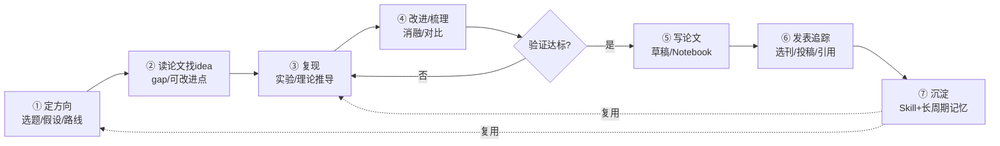

# 架构设计文档 — 格物 (Gewu)

> 通用学术科学智能体。基于 **书生大模型 + OpenClaw 原生编排** 构建；
> 以「大颗粒原煤 LIBS 光谱热值预测」作为**参考实现**证明深度与可复现性。
> OpenClaw 为 **MIT 开源、本地优先** 的执行框架（当前稳定版 v2026.10.x），无需克隆其源码。

### 当前落地状态（2026-10-22 已验证）
- ✅ OpenClaw v2026.10.5 安装并常驻运行（Gateway `gateway probe` 连通，`config validate` 通过）。
- ✅ 书生模型 provider `sheng`（Intern-S1 / InternVL）已配置。
- ✅ 8 个 MCP 服务（7 个 Python + 1 个 Node 包装）经 `openclaw mcp add` 注册到 `mcp.servers`，`mcp probe` 实测全部拉起并暴露工具。
- ✅ 7 个科研 Agent（`agents.ownership="explicit"`）已注册，各用独立工作区 `AGENTS.md` 承载角色，技能自动发现。
- ⏳ 待办：填 `INTERN_API_KEY` 跑真实规划；导出 OpenVINO MIL 模型 + 接真实 LIBS 数据跑实参考实现；完善技术文档与演示材料。

## 0. 产品定位（与"论文翻译/管理"工具的根本区别）
格物**不是**又一个论文翻译、文献管理或笔记整理工具。它覆盖科研的**全生命周期**，
把智能体从"读文献的助手"升级为"全程参与科研生产的合作者"：

- 普通工具止步于 **读 / 整理**；
- 格物贯穿 **定方向 → 读论文找 idea → 复现 → 改进/梳理 → 写论文 → 发表追踪 → 沉淀**，
- 且「沉淀」把本次方法/知识固化为可复用的 **OpenClaw Skill** 与**长周期记忆**，
  在下一个课题中被直接复用 —— 系统**越用越强（复利闭环）**，这正是科研团队的核心能力。

## 1. 架构总览（原生 OpenClaw）
本项目**不自己写控制流编排器**。OpenClaw 原生已具备：多智能体编排（`sessions_spawn`
支持 `main → orchestrator → worker` 层级）、Skills（`SKILL.md`）、Memory（长周期记忆）、
A2A（announce 跨会话）、Computer Use（Browser/Exec）。因此架构收敛为三层：

| 层 | 角色 | 本项目落地 |
|---|---|---|
| **书生大模型** (Intern-S1 / InternVL) | 大脑（推理 / 规划 / 视觉） | 经 OpenAI 兼容 `base_url` 接入 OpenClaw model profile |
| **OpenClaw** | 执行框架（身体） | Gateway、原生多智能体编排、Skills 加载、Memory、渠道、Computer Use、A2A |
| **格物科研智能体层** | 科研领域能力 | 7 阶段 Agent（注册于 `openclaw.json` 的 `agents.entries`，各用独立工作区 `AGENTS.md` 承载角色）+ Python MCP 工具层 + 领域包 + Skills |

> Python **只保留"科学工具层"**（MCP Server），通过 MCP 被 OpenClaw 调用；
> 控制流（7 阶段流转、迭代循环）完全交给 OpenClaw 原生编排。
> 这样只有**一个 planner**（OpenClaw 自身），不存在"双层 LLM 规划"的效率损耗。

## 2. 科研全生命周期（7 阶段）

- **内循环（假设—实验—验证—迭代）**：①→②→③→④，④ 不达标则回到 ③ 再迭代，构成端到端科学发现闭环。
- **终态阶段**：⑤→⑥→⑦，产出论文、发表追踪与可复用资产。
- **复利**：⑦ 的沉淀在后续课题的 ①/③ 被复用。

> 「搜、读、算、做、写」是上述生命周期中 **②读 → ③复现 → ④改进 → ⑤写** 的子链；
> 格物在其前后补齐了 ①定方向、⑥发表追踪、⑦沉淀，构成完整科研生产流。

## 3. 原生多智能体编排（OpenClaw 实现）
### 3.1 角色 → OpenClaw Agent 映射
7 个阶段在 OpenClaw 中表达为 **`agents.entries` 里注册的 7 个 Agent**（`agents.ownership="explicit"`，
每个 Agent 有独立工作区，角色由工作区内的 `AGENTS.md` 承载，技能从工作区 `skills/` 自动发现），
由 Director（①）作为协调者通过 `sessions_spawn` 派发后续阶段：

| OpenClaw Agent | 阶段 | 职责 | 关键工具 / 技能 |
|---|---|---|---|
| `director` | ① 定方向 | 提出研究问题、假设、技术路线；协调后续阶段与迭代循环 | 全部 Skills、Memory |
| `ideation` | ② 读论文找 idea | 检索+精读+多模态解析，抽取 gap 与可改进点 | `paper-search` / `sci_data` / InternVL |
| `reproduction` | ③ 复现 | 实验/理论推导复现，调通用计算与领域模型 | `sci_compute` / `mil_model` / Exec |
| `improver` | ④ 改进/梳理 | 消融、对比、复现性验证，并对质量打分 | `sci_compute` / `report` |
| `writer` | ⑤ 写论文 | 论文草稿、图表、可复现 Notebook | `report` / `sci_data` |
| `publication` | ⑥ 发表追踪 | 选刊、投稿、审稿应对、引用追踪 | Browser / `paper-search` |
| `distillation` | ⑦ 沉淀 | 把方法/知识固化为 Skill + 长周期记忆 | Skills 写盘 / Memory |

### 3.2 状态在阶段间的传递
原生 OpenClaw 不走"参数传对象"，而是用三种机制传递科研上下文：
1. **Workspace 文件**：各阶段把产出（假设、文献笔记、实验指标、草稿）写入工作区文件，
   下一阶段读取 —— 大对象（数据集、权重）始终留在 Python/MCP 侧，只跨边界传路径/ID。
2. **Memory（长周期记忆）**：OpenClaw Memory Core（`MEMORY.md` + 向量/混合检索）承载跨会话知识。
3. **A2A announce**：子智能体结束时向协调者 announce 结果摘要，驱动流转。

### 3.3 确定性迭代循环（不达标回③）的解法（已核实）
经 OpenClaw 官方文档核实：**lobster 原生不支持循环 / 回退边**——
文档明确 "Loop semantics such as maxIterations or shell-condition loops were proposed in
lobster#20, which was closed without merging"（提案被关闭未合并）；且自调用工作流会报 `cycle error`。
lobster 实际支持的是 `when/condition`（条件**跳过**步骤）、`retry`（步骤级重试）、
`for_each`（遍历）、`workflow`（子工作流，但禁止自循环）。

因此改用更鲁棒的两层方案（**不使用 lobster 原生回路**）：
- **`for_each` 固定 N 轮迭代（首选）**：把"一轮复现→改进→校验"封装为一个步骤组，用 `for_each`
  跑 K 轮（如 5 轮），每轮质量分写入 Memory，末位由 `improver/writer` 汇总选优。
  这恰好契合"假设—实验—验证—迭代"的多轮闭环，且不依赖 LLM 每次自己想起来回退。
- **Agent 层控制（动态加码）**：当 `director` 判定还需打磨，由它在会话内再 `sessions_spawn`
  一轮 `reproduction` 子智能体（在 `director` 的 system prompt 写明"最多 N 轮"作为护栏）。
- **不保留独立 Python 控制器**——循环逻辑交给 lobster(`for_each`) 或 OpenClaw 原生多智能体即可，
  与"控制流全交给 OpenClaw"的架构原则一致。

## 4. MCP 工具层（Python / Node Server，被 OpenClaw 经 MCP 调用）
| 服务 | 职责 | 通用/领域 |
|---|---|---|
| `sci_compute` | PCA / PLS / 曲线拟合 / 交叉验证 / 超参寻优 | 通用 |
| `paper-search` | arXiv/Crossref/OpenAlex/Semantic Scholar/PubMed 多源检索（paper-search-mcp，零 key 即可用） | 通用 |
| `sci_data` | 科学文件与图表载入解析（InternVL 视觉） | 通用 |
| `mil_model` | **真实** MIL 热值预测（4 工具：`predict_calorific_value` / `list_val_bags` / `reproduce_fold` / `cv_summary`）；经 `coal_infer.py` 按路径引用外部未发表项目的 `.pt`/`.pkl` 做真实前向推理，可逐 bag 复现 5 折交叉验证（见 §4.5） | 领域专属（真实推理） |
| `report` | 报告 / 论文草稿生成；并含「本地写 LaTeX」工具族（`write_local_file` / `write_latex_project` / `copy_local_file`），把 .tex/.bib 源文件落盘本机，不依赖 Overleaf | 通用 |
| `sci_plot` | 含实验数据的统计图（本地 matplotlib 渲染，PDF 矢量 + PNG 300dpi，17 工具） | 通用 |
| `chart-cloud` | 纯结构/概念图（Node 包装 @antv/mcp-server-chart 云端出图：思维导/桑基/鱼骨/组织架构/地图等 12 工具；已用 `DISABLED_TOOLS` 禁用全部含数据图类型） | 通用 |
| `office-word` | 本地生成/排版 Word 文档（python-docx，54 工具：mcp probe 实测；建/写标题段落表格、单元格底纹合并、字体颜色、搜索替换、`convert_to_pdf` 等），用于中文期刊/学位论文成稿 | 通用 |

> MCP 语言无关，是打通 OpenClaw(TS) 网关与 Python 科学引擎的桥，也是本项目采用的工具调用协议。

### 4.1 `paper-search` 接入要点（已踩坑）
- 仓库：`https://github.com/openags/paper-search-mcp`（MIT，0.1.4）。**独立 venv** 安装，避免与 gewu 既有 `mcp<2` 服务混装：
  ```
  ~/.workbuddy/binaries/python/versions/3.13.12/python.exe -m venv \
    ~/.workbuddy/binaries/python/envs/paper-search
  paper-search/Scripts/python.exe -m pip install "paper-search-mcp" -i https://pypi.org/simple
  paper-search/Scripts/python.exe -m pip install "mcp[cli]<2"   # ⚠️ 必钉！见下
  ```
- **⚠️ 发布版打包 bug**：PyPI 上 `0.1.4` 的元数据写 `mcp[cli]>=1.6.0`（无上限），pip 会拉到 `mcp 2.x`，但 `server.py` 实际用 mcp 1.x 的 `mcp.server.fastmcp.FastMCP`（2.x 已删除该路径），启动即 `ModuleNotFoundError`。**必须显式钉 `mcp[cli]<2`**（实测 1.30.0 可用）。独立 `fastmcp` 包虽被拉入但代码未引用，无影响。
- 启动：`python -m paper_search_mcp.server`（stdio）。默认零 key 即可用 arXiv/Crossref/OpenAlex/Semantic Scholar/PubMed；CORE/DOAJ/Unpaywall 为可选 key 源。
- 主工具：`mcp__paper-search__search_papers`（统一多源，`sources` 默认 `all`，建议 Agent 传 `arxiv,semantic,crossref,openalex,pubmed` 避开 google_scholar 反爬与需 key 源）。
- 旧占位 `lit-search` 已退役（删 `gewu/mcp/lit_search.py`、移出 config、改 `ideation/AGENTS.md`）。

### 4.2 混合出图策略（本地 `sci-plot` + 云端 `chart-cloud`）

- **核心原则**：**含实验测量数据的图 → 本地；纯结构/概念图 → 云端。**
  - 含数据的统计图若走云端，需把数据 POST 到公有云渲染（见下），对「本地优先、含未发表
    实验数据」的格物是**数据出域**硬伤，且产物是栅格图而非出版级矢量图。
  - 思维导图/桑基/鱼骨/组织架构/地图等**不含测量值**，无出域风险，且 matplotlib 天生
    不擅长，故交给云端方案更省力。
- **本地一半 —— `gewu/mcp/sci_plot.py`（Python，matplotlib）**：
  - 覆盖全部含数据统计图（光谱/折线/面积/散点/预测-真实/残差/柱/箱线/小提琴/直方/热力/
    多曲线/饼/雷达/双轴/瀑布，共 17 工具），每次同时输出 **PDF（矢量，投稿用）+ PNG（300 dpi，嵌入 docx 用）**，
    返回两者绝对路径；依赖 `matplotlib>=3.8`（`requirements.txt` 已列）。
  - 踩坑：无 GUI 须先 `matplotlib.use("Agg")`；中文标签内置 `Microsoft YaHei`/`SimHei` 回退 +
    `axes.unicode_minus=False`；`boxplot` 标签参数在 3.9+ 为 `tick_labels`。
- **云端一半 —— `gewu/mcp/chart_cloud.mjs`（Node 包装 @antv/mcp-server-chart）**：
  - `mcp-server-chart`（AntV，MIT，26+ 图）的出图流程是**把数据 POST 到
    `https://antv-studio.alipay.com/api/gpt-vis` 公有云渲染，返回远程图片 URL**——工具只返回
    URL 文本，不代下载，图片存于对方服务器。
  - 我们用一个**包装脚本**在启动前注入 `DISABLED_TOOLS`，**关掉全部 15 个含数据的图类型**
    （line/area/scatter/column/bar/dual_axes/boxplot/violin/histogram/pie/radar/waterfall/venn/
    liquid/spreadsheet），**只保留 12 种结构图**（mind_map/fishbone/flow/sankey/network_graph/
    organization/funnel/treemap/word_cloud/三类中国地图）。这样从配置层面**强制实验数据无法
    经云端离开本机**。
  - 换机操作：先 `npm install -g @antv/mcp-server-chart`，包装脚本会经 `npm root -g` 动态定位入口。
- **分工边界**：agent 需要画折线/散点/柱状/饼/雷达等统计图 → 一律 `sci-plot`；需要思维导/
  桑基/鱼骨/组织架构/地图 → `chart-cloud`。若把真实实验数据塞进 chart-cloud 的图即违反此边界。

### 4.3 文档成稿层（`office-word` + `report` 本地写 LaTeX 工具族）

- **为什么要这一层**：格物的科学计算/绘图已闭环，但此前 `report` 只产出文本草稿，缺少把
  「正文 + 图」组装成**可投稿真实文档文件**的环节。`office-word` 与 `report` 的本地写 LaTeX
  工具族正是补齐这最后一环的"成稿/排版输出"层。
- **两条成稿路径（按目标期刊/学位论文格式二选一）**：
  1. **Word 路径（`office-word`，本地）**：中文核心期刊、硕士学位论文多为 Word 模板，用
     `office-word` 直接产出 `.docx`（标题/段落/表格/底纹/字体/搜索替换俱全，`convert_to_pdf`
     在 Windows 走本机 Word）。**全程本地，不出域。**
  2. **LaTeX 路径（`report` 的本地写 LaTeX 工具族，本地）**：若投 LaTeX 期刊或自用本地 TeX 编译，
     用 `write_latex_project` 一次性把 `main.tex` + 各 `sections/*.tex` + `refs.bib` 写入本机
     目录；`write_local_file` 写单文件；`copy_local_file` 把 `sci-plot` 生成的 PDF/PNG 矢量图
     拷进项目 `figures/`。**不依赖 Overleaf**（Overleaf 会把稿件推到第三方云，与"本地优先"
     原则有张力，故不接入）。
- **office-word 接入要点（已踩坑）**：
  - 该服务基于**独立 `fastmcp` 2.x 包**（与 default venv 的 `mcp<2` 不是一回事），**必须独立 venv**
    安装，否则会污染其余 6 个 Python MCP 服务。venv 路径：`~/.workbuddy/binaries/python/envs/office-word`。
  - 安装：`office-word/Scripts/python.exe -m pip install "office-word-mcp-server"`（或本地源码目录
    `E:/UNpress/Office-Word-MCP-Server-main`；tuna 镜像曾拉不到构建后端 `hatchling`，改用
    `https://mirrors.aliyun.com/pypi/simple` 成功）。
  - 启动：`python -m word_document_server.main`（stdio，默认传输）。该包在导入/启动时会向 stdout
    打印若干状态行，实测经 OpenClaw `mcp probe` 仍可正常列出工具；若某版本打印破坏 stdio 协议，
    则在 `gewu/mcp/` 加一个启动器把导入期 stdout 导向 stderr 后再 `mcp.run()`。
  - `convert_to_pdf` 依赖本机 MS Word（Windows）或 LibreOffice（Linux）；仅是可选工具，不调用则无影响。

### 4.4 科研阅读闭环（反幻觉 + 书生原页理解 + 评审循环）

这是格物"本地优先、功能化激发书生"的关键闭环，把 ARIS（Auto-claude-code-research-in-sleep）
的成熟工程纪律移植过来，**挑着用、改着用**，不整库搬：

- **① 反幻觉校验（`gewu/mcp/verify_papers.py`，移植 ARIS + 一层实测补丁）**：纯标准库 CLI，
  零依赖。校验链 arXiv API 批量 → CrossRef DOI → Semantic Scholar 模糊标题匹配
  → **CrossRef 标题检索回退（本项目实测补的第 4 层）**，在下游分析前拦掉 LLM 编造的
  arXiv ID/DOI/标题。与格物 `paper-search`（返回结构化 `arxiv_id/doi/title`）天然契合——
  检索后把候选写成 JSON，Bash 调脚本即得 `verified/unverified/verify_pending` 标记，
  绝不沉默丢弃未验证项。
  第 4 层的由来：只有标题、没有 DOI 的文献原本一律落到 S2，**无 key 时几乎必然 429 →
  全部 pending，校验形同失效**（2026-10-23 实测三篇英文 LIBS 论文时命中）。补
  `verify_title_crossref()`（相似度 ≥0.82 才接受 DOI）后，真实论文稳定命中、
  编造标题仍判 `unverified`。
- **② 书生科学多模态原页理解（本项目的核心差异点）**：这是书生 intern-s2 相对纯文本模型的
  最大价值——直接在统一表征空间联合理解图/表/公式。落地方式：
  `render_pdf_pages`（sci-data，PyMuPDF 渲染）→ `image_to_data_uri`（转 base64）→
  把 `data_uri` 作为 `image_url` **直接发给 `sheng/intern-s2`**，让它对原页做跨模态联合推理
  （图与正文方法矛盾、公式与表格数据对不上等）。**关键：不再先经 InternVL 转文本再喂 S2**——
  那样会切断原页理解能力，使 S2 退化成"文本规划器"。由 `gewu-lit-review` 技能承载（部署于 ideation）。
  渲染前先用 `pdf_page_map` 探明含图页（或 `pages="figtab"`），避免按正文图号猜页码造成空转。

**实测验证（真实中文 LIBS 论文，13 页，含图/表/公式）**——原页理解已跑通，非纸面宣传：
- **读图内标注**：识别出图6 六个散点子图（含 45° 参考线、Validation/Test 图例），
  读出图内标注的 `RMSEp=1.097 / MAEp=0.934`、图5 PCA 方差解释率
  `PC1 47.9%/43.2%`、`PC2 17.9%/28.3%`。**这些数值只存在于图中，PDF 文本层完全没有**，
  纯文本/OCR 路线永远拿不到——这是原页理解相对文本抽取的核心增量。
- **跨页联合推理**：把"结果页 + 方法页"两页同时喂入，它指出结果页把优势归因于
  "缓解分布差异"，但方法页损失函数并无域适应/分布鲁棒项，即**结论归因缺方法层显式支撑**。
- **拒绝编造**：当被问到页面上实际不存在的图时，它如实回答"该页未包含该图，
  无法做视觉判读"而非虚构坐标与趋势——这正是科研场景需要的品质。
- **图表问答**：对自绘回归散点图，准确读出 `R²=0.8786 / RMSE=218.6113 / MAE=173.9017 / n=14`
  （与真实值完全一致），并指出高热值端（~5700）偏离最大。

**实测验证②（三篇英文正式期刊论文，2026-10-23）**——完整记录见
`docs/verification/2026-10-23-english-papers.md`：
- **文本层近乎空白的页面也能读**：Talanta 2025 那篇 p5 的文本层只有 486 字符（仅图注），
  书生仍完整读出 Fig.3 流程图的 Step 1–8 与分组标注、方法示意图的
  `Position 1/k/n`、`Time 1/n`、`HOG feature`、矩阵 `A`、`C = A·f(I)` 等符号——
  这些**只存在于图中**，是纯文本路线拿不到的增量。
- **抗幻觉两面样本**：问"图中没有"的量（Fig.6 的 RMSE）时答"图中仅标注 R²，
  RMSE 仅见于 Table 3"，未把表格数字冒充为图内读数；问渲染错页的图号时答
  "本页只有 Fig.8，Fig.7 不可见"并拒答。同一批测试中亦发现两类风险：
  **数字末位/位序误读**（`0.8851`→`0.8551`、`0.9616`→`0.9619`）与
  **长输出前后自相矛盾**（同一回答中表格写 `/` 而结论段给出具体值）。
  → 已固化为 SKILL 纪律：关键数字二次复读 + 与正文表格对照、结构化表格一次性输出。
- **③ 评审循环（`gewu-review-loop` 技能，部署于 improver / publication）**：把 ARIS
  `auto-review-loop` 的"评分+最小修复+最多 N 轮"纪律移植，但**不依赖 Codex/Gemini 外部后端**——
  改用本机 `sheng/intern-s2` 当对抗评审（符合本地优先），`review-stage/AUTO_REVIEW.md`
  追加式记录、 `REVIEW_STATE.json` 防上下文压缩丢失。
- **模型路由铁律**：原页/图/公式 → `sheng/intern-s2`（多模态）；机械任务 → `intern-s1-mini`；
  判断/规划/写作 → `intern-s2`/`intern-s1-pro`。书生在格物里既是"长程科研智能体调度器"，
  也是"通专融合可插拔"的内核，更是"科学多模态原页理解"的唯一承载者——三者同时被功能化使用。

### 4.5 领域模型接入：真实模型 × 未发表数据的「路径引用」机制

格物的领域建模能力（`mil-model`）此前是占位实现（返回硬编码 demo 值），现改为**真实推理**。
核心设计是**路径引用（path reference）而非复制入库**——这是「未发表论文项目」接入的通用解法。

#### 要解决的问题
用户的 MIL+LIBS 煤热值项目**尚未发表**，模型权重（`.pt`）、PLSR 模型（`.pkl`）、
LIBS 光谱数据（CSV）与 5 折交叉验证结果均属未公开资产，**不能进入格物仓库、更不能上云**。
但格物又必须跑出**真实、可复现**的预测，否则整个智能体只是演示外壳。

#### 解法：三层隔离

| 层 | 位置 | 是否入库 |
|---|---|---|
| 胶水代码 | `gewu/mcp/coal_infer.py`（纯代码，零模型零数据） | ✅ 入库 |
| MCP 封装 | `gewu/mcp/mil_model.py`（subprocess 调胶水，解析 JSON） | ✅ 入库 |
| 模型 + 数据 | 用户原项目目录（如 `coal-calorific-value/`） | ❌ 永不入库 |

运行时通过 `COAL_PROJECT_ROOT`（或 gitignore 的 `.coal_project_root` 文件）定位外部项目，
**仓库内不写死任何机器绝对路径**。新增领域模型只需换一个根目录，机制通用。

#### 推理链（严格对齐训练脚本，保证可复现）
```
bag(多张 LIBS 谱 CSV)
  → parse + is_valid_spectrum 过滤
  → 预处理 sg → als → mms
  → 袋均谱 → PLSR(n=7) 预测                 → plsr_pred
  → 实例矩阵 → MIL(ResNet1D+TransMIL_attn + FiLM) → 残差 → mil_res
  → hybrid(kcal/kg) = plsr_pred + mil_res   → ×0.004184 → MJ/kg
```
模型重建超参、`kfold_split_bags(seed=42)` 划分、`spec_len` 裁剪均与训练脚本逐项对齐，
因此 `reproduce_fold` 能**逐 bag 复现**原项目 5 折交叉验证的预测值。

#### 暴露的工具
`predict_calorific_value`（单 bag 真实预测）/ `list_val_bags` / `reproduce_fold`（复现某折）
/ `cv_summary`（5 折指标 + 与官方 summary.json 交叉校验）
/ `get_cached_metrics`（秒级读缓存指标，零 torch）/ `expand_result`（回取被瘦身的大结果）。

> **设计原则**：模型权重与未发表实验数据**始终留在用户本机原目录**，格物只按路径读取；
> 换领域 = 换 `COAL_PROJECT_ROOT`，内核零改动。

> **部署铁律（实测纠正 2026-10-29）**：`mil_model.py` 以 subprocess 起 torch 孩子进程，
> 必须 `stdin=subprocess.DEVNULL`。少了这一行，孩子进程会继承 MCP 那根 JSON-RPC stdin 管道并
> 挂到自己的 timeout——历史上把这误诊为"MIL 推理慢/单步要 1~2 分钟"，于是 `cv_summary`
> 判 60s 超时、`list_val_bags` 判 600s 超时。修复后实测：`cv_summary` 0.2s、
> `list_val_bags` 2.7s、`predict_calorific_value`（真实 torch 前向）18.8s、
> `reproduce_fold` 整折 14 bag 10.7s。回归守护见 `tests/test_stdio_subprocess_guard.py`。

> **超时层级铁律（实测纠正 2026-10-30）**：工具内的 `timeout` 必须**严格小于** MCP 客户端的
> `requestTimeoutMs`，并留出把错误 JSON 送回模型的余量（`mil-model` 客户端 900s − 60s = 840s 上限，
> `_run()` 会把更大的入参夹回来）。错配的代价实测过：会话 `coal-demo-v3`（2026-10-28）里
> `reproduce_fold` 内部允许跑 1800s，客户端 900s 先炸成 `MCP error -32001: Request timed out`，
> 模型**拿不到**我们那句「改用逐 bag / 分批」的可执行建议，退化成一串 `exec` 摸索，
> 整会话 2404s 撞墙超时——90% 的墙钟花在 4 次 MCP 调用内部，与 prompt 体积无关。
> 常量与守护：`gewu/mcp/mil_model.py` 的 `CLIENT_REQUEST_TIMEOUT_S / TIMEOUT_HEADROOM_S /
> MAX_TOOL_TIMEOUT_S` + `tests/test_mcp_timeout_hierarchy.py`（同时校验源码 gate 与
> `openclaw/openclaw.json` 模板里的 `requestTimeoutMs` 仍自洽）。
> 另一条链路 `gewu/domain_packs/coal_libs/tools.py` 的 `_call(timeout=900)` 不经 MCP 客户端拉起，
> 不受此层级约束。

### 4.6 工具结果瘦身层（CCR：摘要 + 落盘 + 回取）

大结果直接灌进上下文会让长任务在写论文阶段之前就被截断，但格物的卖点是**数值可溯源**，
所以 `gewu/mcp/context_compactor.py` 只做**结构化去冗**，不做截断、也不做 LLMLingua 式
token 删减（`RMSE=214.5699±25.7094` 这类串一旦被改写，整条复现链就失效）。规则：

- 标量（数值、短字符串）**逐字保留**；超长同构列表只内联前 `head` 条，其余给出可直接
  使用的 `selector`；列表内重复的长公共前缀提取一次、逐条去掉；低基数字段给 `_tally`
  全量计数；数值字段给真实 `numeric_min_max`。
- 原文**字节级落盘**（`~/.gewu/mcp-raw/<日期>/<server>.<tool>.<sha1前12>.json`），
  `expand_result(path, selector)` 读的就是那份文件。文件名由**内容**决定：同一份原文
  只会有一份文件，摘要与原文永远同源（若按 `(tool,args)` 命名，`verify_papers` 这类
  两次调用之间本身会漂移的结果会让第二次的摘要指向第一次的原文）。
- **省不到 12% 就不压**（`MIN_SAVING`）：信封自身有 400–500 字符固定开销，实测
  `reproduce_fold` 压缩后反而 3,128→3,219 字符；压了却更长等于白付一次回取往返的风险。
- 代价与纪律：一次 `expand` ≈ 一次网关往返（轮次粒度 10–20s），所以阈值默认只处理
  超过 3,000 字符的结果，小结果零开销透出。`digest` 里没有的条目等于没看过，
  不许凭印象补——该纪律写进 `research_lifecycle` 技能「⑧ 大结果读取纪律」，
  由三个服务的 `expand_result` docstring 各自复述一遍。

已接入 `mil-model` / `sci-verify` / `sci-data` 三个服务。**实测瘦身比**（传输口径
`json.dumps(..., indent=2)`，与 MCP lowlevel server 序列化一致）：
`sci-data.pdf_page_map`(32 页) 5,531→2,851（48.5%）、`mil-model.list_val_bags`(14 bag)
3,700→2,749（25.7%，14 条完整 `bag_dir` 可由 `expand_result` 逐字恢复）、
`sci-verify.verify_papers`(20 篇) 4,162→2,637（36.6%，`tally` 让"几条未核验"不回取也能下结论）。
例外：`sci-data.image_to_data_uri` **不走瘦身**——它返回的 base64 是喂给模型的图像载荷而非数据，
摘要化等于废掉工具；它改由 600,000 字符硬闸把关（实测整页 dpi=150 = 706,800 字符会被拒，
dpi=130 = 572,204 可用），并把 `render_pdf_pages` 默认 dpi 从 150 降到 130。

## 5. 领域包（参考实现：coal_libs）
- `knowledge.md`：LIBS 原理、煤质热值背景、MIL 方法说明（供 RAG / 长周期记忆）。
- `tools.py`：用**通用工具组合**出「LIBS 谱图 → 预处理 → MIL 预测」的领域工作流，而非写死。
- 换领域只需新增一个 `domain_packs/<domain>/`，不影响内核。

## 6. Agent Skills（即 OpenClaw Skills）
技能源文件位于 `gewu/skills/` 与 `openclaw/skills/`，已复制到每个 Agent 工作区的 `skills/`
目录，**由 OpenClaw 从工作区自动发现加载**（无需在 config 显式列名）：
- `spectrum_preprocess/SKILL.md`：谱图预处理技能。
- `mil_calibration/SKILL.md`：MIL 校准技能（即「沉淀」阶段可固化的典型资产）。
- `research_lifecycle/SKILL.md`：编码 7 阶段工作流，作为 Director 的元技能（已完成）。

## 7. 长周期记忆与沉淀
- **记忆**：实验记录、论文迭代版本、领域知识存入 OpenClaw Memory，支撑上下文工程与跨会话复用。
- **沉淀**：`distillation` 把可复用方法写盘为新的 `SKILL.md`、把知识写入 Memory，下一课题直接调用。

## 8. OpenClaw 项目结构与落地
### 8.1 需要克隆 OpenClaw 源码吗？
**不需要。** OpenClaw 是"你运行的一个平台"（MIT，本地优先），不是 import 的库。
正确做法是 **安装 OpenClaw（npm / 官方安装脚本）**，再在**本项目工作区**放置我们自己的
Skills / Agents 配置 / MCP 服务 / 领域知识——这些才是本项目自有的核心代码。
仅在"改 OpenClaw 核心源码 / 给它提 PR"时才需要 `git clone https://github.com/openclaw/openclaw`。

### 8.2 目标目录结构（本项目 = OpenClaw 之上的科研智能体层）
```
gewu-sciagent/
├── openclaw/                  # OpenClaw 项目（提交层的"应用"）
│   ├── openclaw.json          # 网关配置：书生模型 / agents.entries / mcp.servers（真实 schema）
│   ├── skills/                # 3 个 Skill 源（已复制进各 Agent 工作区 skills/）
│   └── workspace/             # 共享 MEMORY.md / 数据 / 产出
│       └── agents/<role>/     # 7 个 Agent 各自工作区，各含 AGENTS.md + skills/ + MEMORY.md
├── gewu/                      # Python 工具/技能/领域源码（被 OpenClaw 经 MCP 调用）
│   ├── mcp/                   # 8 个 stdio MCP Server（sci_compute/sci_data/mil_model/report/sci_plot/office-word 为 Python；chart_cloud.mjs 为 Node 包装）
│   ├── skills/  domain_packs/
├── docs/  data/  README.md
```
> Agent 角色**不写在 config 的某字段**，而是每个 Agent 工作区内的 **`AGENTS.md`**（OpenClaw 原生约定）；
> 多智能体花名册需在 `agents.ownership="explicit"` 下于 `agents.entries` 登记各 Agent 的
> `workspace` 与 `identity`。

### 8.3 openclaw.json 配置示意（真实 schema，已验证 `config validate` 通过）
> 配置文件位于 `~/.openclaw/openclaw.json`（JSON5，支持注释）。完整已验证版本见 `openclaw/openclaw.json`。

```json5
{
  // 1. 书生大模型：自定义 OpenAI 兼容 provider（Intern-S1 作推理/规划，InternVL 作视觉）
  "models": {
    "mode": "merge",
    "providers": {
      "sheng": {
        "baseUrl": "https://internlm.intern-ai.org.cn/api/v1",
        "apiKey": "${INTERN_API_KEY}",
        "api": "openai-completions",
        "models": [
          { "id": "Intern-S1", "name": "书生·Intern-S1", "input": ["text"], "contextWindow": 200000 },
          { "id": "InternVL",  "name": "书生·InternVL",  "input": ["text","image"], "contextWindow": 200000 }
        ]
      }
    }
  },
  // 2. 智能体：多智能体花名册 ownership=explicit；每 Agent 独立工作区（AGENTS.md 承载角色）
  "agents": {
    "ownership": "explicit",
    "defaults": { "model": { "primary": "sheng/Intern-S1" }, "workspace": "./openclaw/workspace" },
    "entries": {
      "gewu-director":     { "workspace": "./openclaw/workspace/agents/gewu-director",     "identity": { "name": "格物·主编" } },
      "gewu-ideation":     { "workspace": "./openclaw/workspace/agents/gewu-ideation",     "identity": { "name": "格物·探员" } },
      "gewu-reproduction": { "workspace": "./openclaw/workspace/agents/gewu-reproduction", "identity": { "name": "格物·复现员" } },
      "gewu-improver":     { "workspace": "./openclaw/workspace/agents/gewu-improver",     "identity": { "name": "格物·改进员" } },
      "gewu-writer":       { "workspace": "./openclaw/workspace/agents/gewu-writer",       "identity": { "name": "格物·写手" } },
      "gewu-publication":  { "workspace": "./openclaw/workspace/agents/gewu-publication",  "identity": { "name": "格物·发表官" } },
      "gewu-distillation": { "workspace": "./openclaw/workspace/agents/gewu-distillation", "identity": { "name": "格物·沉淀师" } }
    }
  },
  // 3. MCP 工具层（Python stdio server；经 `openclaw mcp add` 注册到 mcp.servers）
  "mcp": {
    "servers": {
      "sci_compute": { "command": "/ABS/venv/python", "args": ["/ABS/gewu/mcp/sci_compute.py"], "cwd": "/ABS" },
      "mil_model":   { "command": "/ABS/venv/python", "args": ["/ABS/gewu/mcp/mil_model.py"],   "cwd": "/ABS" }
      // lit_search / sci_data / report 同此
    }
  }
}
```

## 9. 设计权衡与能力覆盖
| 维度 | 本项目的应对 |
|---|---|
| 实用价值 | 通用内核 = 广价值；全生命周期（含复现/发表/沉淀）= 真科研痛点；煤热值 = 可复现证据 |
| 技术深度 | 书生模型 + OpenClaw 原生多智能体 + 通用 MCP 工具层 + 多模态 + 本地 OpenVINO + Agent Skills + 长周期记忆 + A2A |
| 完整度 | 7 阶段在参考实现上跑通，文档 + 视频齐全 |

## 10. 分阶段落地路线图（已验证进展 ✓）
1. **安装 OpenClaw + 建项目骨架** ✓：OpenClaw v2026.10.5 经独立 **Node 26.9.0**（因要求 Node ≥24.16/<25 或 ≥26.1，本机 22/24 不满足）全局安装；`openclaw/openclaw.json` 已合并进 `~/.openclaw/openclaw.json` 并通过 `config validate`，Gateway 常驻运行、`gateway probe` 连通。
2. **接书生大模型**：配置 `models.providers.sheng`（OpenAI 兼容 baseUrl）✓；待填 `INTERN_API_KEY` 后跑通真实规划（缺 key 时 config 仅 warning，不阻断启动）。
3. **迁入 MCP 工具层** ✓：6 个 `gewu/mcp/*.py`（sci_compute/sci_data/mil_model/report/sci_plot）+ 1 个 Node 包装 `chart_cloud.mjs` 本就是合法 FastMCP/stdio server；Python 侧 venv 内 `mcp` 固定为 1.x 后导入正常，经 `openclaw mcp add` 注册到 `mcp.servers`，`openclaw mcp probe` 实测 8 个服务全部拉起并列出工具（`sci_compute` 含 PCA/PLS/拟合/交叉验证 4 工具；`sci-plot` 17 工具；`chart-cloud` 12 工具）。
4. **写 7 个 Agent 角色** ✓：`agents.ownership="explicit"`，7 个 `agents.entries` 各指向独立工作区，角色写在工作区 `AGENTS.md`，技能从 `skills/` 自动发现；`config validate` 通过、Gateway 识别 7 个 Agent。
5. **Skills 化** ✓：`spectrum_preprocess` / `mil_calibration` / `research_lifecycle` 三个 Skill 已就位并复制到各工作区。
6. **参考实现跑实** ✓：领域模型不再依赖 OpenVINO 导出，改为**按路径引用外部未发表项目**做真实推理
   （`coal_infer.py` 复用原项目 `src/` 的解析/预处理/模型结构，逐项对齐训练脚本）。
   `mil_model` 已能产出**真实热值预测**并逐 bag 复现 5 折交叉验证指标；
   模型权重与 LIBS 数据始终留在用户本机原目录，不入库、不上云（见 §4.5）。
7. **沉淀闭环 + 文档**（待做）：`distillation` 真正写盘 Skill + 更新长周期记忆；完善技术文档与演示材料，提供可访问体验。
